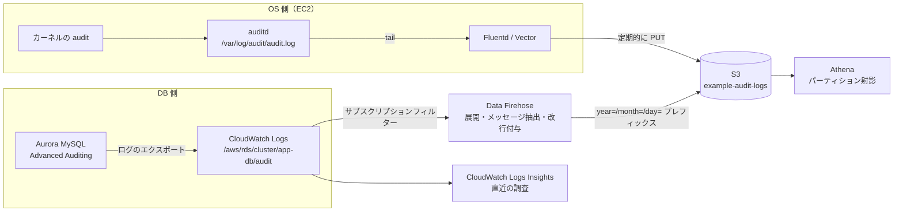
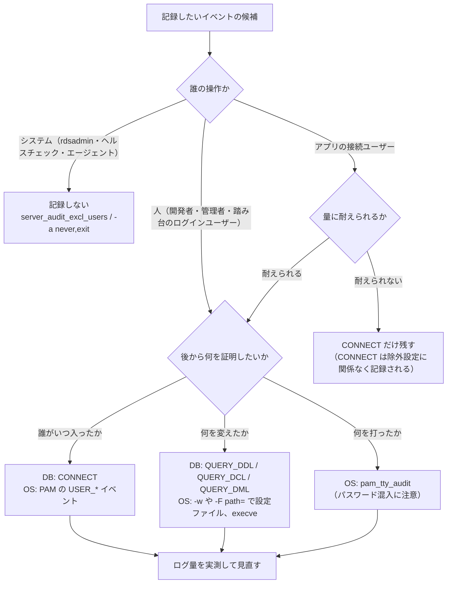

Aurora MySQL の監査ログ（Advanced Auditing）と、EC2（Amazon Linux）の auditd のログを S3 に集めて Athena で検索する基盤を作ったときに踏んだところを、19 個にまとめました。時間を使ったのは設定そのものより、「ログが来ない」「来たけど読めない」「多すぎる」の 3 つでした。一番の学びは、ロググループもエクスポート設定もあるのに `server_audit_logging` が OFF のままで、監査ログが来ていなかったことです（ハマりどころ 1）。

「攻撃を受けたときに、誰が何をしたのか後から追えるようにしておく」ために、Aurora MySQL や EC2 の監査ログを残そうとしている SRE やインフラ担当の人向けです。すぐ下の一覧から、症状が近い番号の項目に飛んで読んでも分かるように書いています。導入したあとに見る項目は、後半の「導入後に確かめること」にまとめました。

実際の構成を設計メモとして一般化し、原因は一次情報で確かめ直しています。

名前や値はすべて例に置き換えています。クラスター名は `app-db`、バケット名は `example-audit-logs`、アカウント ID は `123456789012` です。数値は、ドキュメントに書かれている値か、前提を明記した試算だけを載せています。auditd の挙動は、手元の Docker（Amazon Linux 2023 のコンテナ）で再現できたものだけ実際の出力を載せています。

## 既にある記事との違い

個々の構成は、すでに良い記事があります。

- AWS Database Blog の [Automate the export of Amazon RDS for MySQL or Amazon Aurora MySQL audit logs to Amazon S3 with batching or near real-time processing](https://aws.amazon.com/blogs/database/automate-the-export-of-amazon-rds-for-mysql-or-amazon-aurora-mysql-audit-logs-to-amazon-s3-with-batching-or-near-real-time-processing/)（2026 年 1 月）は、エクスポートタスクを定期実行する方法と、Firehose で流す方法の 2 つを比べています
- サーバーワークスさんの [Amazon Aurora の 監査ログ ( pgAudit ) を、ログアーカイブ用の AWS アカウントにある S3 バケットに出力してみました。](https://blog.serverworks.co.jp/aurora-pgaudit-cloudwatch-s3) は、PostgreSQL 版でクロスアカウントの構成です
- DevelopersIO の [auditdを用いてEC2内のファイル転送系コマンドをCloudWatch Logsに収集してみた](https://dev.classmethod.jp/articles/2026-03-26-ec2-auditd-file-transfer-command-logging/)（2026 年 3 月）は、auditd のルールと CloudWatch Logs への収集です
- auditd のルールの基本は [RHELのAudit設定（ファイルアクセス監査）](https://qiita.com/ch7821/items/03bd936dd4cb070001b5) が分かりやすいです

この記事では、DB と OS の監査ログを同じ観点（何を記録するか、どう運ぶか、どれくらいの量になるか）で並べることと、ハマりどころの切り分けを中心にします。

## ハマりどころの一覧

先に一覧を置いておきます。大きく分けると、ログが出ていない（1、6、7、9）、出ているが読めない（5、8、13、14）、多すぎる（2、10、11）の 3 種類でした。詳しくは後半の「ハマりどころ」の節に、症状・原因・対処の順で書いています。

| # | 場所 | 症状 | 原因 |
|---|---|---|---|
| 1 | Aurora | ロググループもエクスポート設定もあるのに監査ログが来ない | `server_audit_logging` が OFF のままだった |
| 2 | Aurora | 内部のクエリでログが埋まる | `QUERY` には Aurora 自身のヘルスチェックも入る |
| 3 | CloudWatch Logs | S3 へのエクスポートが `GetBucketAcl` で失敗、直すと別のエラー | バケットポリシーの Resource の書き方 |
| 4 | CloudWatch Logs | エクスポートは一度きりで、毎日の自動化がない | エクスポートタスクは期間指定の 1 回限りの処理 |
| 5 | Firehose | S3 のファイルが文字化け・1 行になる | CloudWatch Logs からのデータは gzip 済みで、複数イベントをまとめた JSON |
| 6 | Firehose | サブスクリプションフィルターのテストで `PutRecord` が拒否される | Firehose を作り直して名前が変わったのに、IAM の Resource が古いまま |
| 7 | Terraform | サブスクリプションフィルター作成で `ResourceNotFoundException` | ロググループより先にフィルターを作ろうとした |
| 8 | Athena | テーブル作成で `ParseException` | `database` が予約語 |
| 9 | auditd | ルールを足したのに何も記録されない | Amazon Linux 2023 の既定ルール `-a task,never` |
| 10 | auditd | 失敗したシステムコールでログが膨らむ | ノンブロッキングの `connect` や存在しないファイルの `openat` も「失敗」として残る |
| 11 | auditd | 調べるたびにログが増える | `ausearch` / `aureport` 自体が execve のルールに引っかかる |
| 12 | auditd | ルールを変えようとすると拒否される | `-e 2` で固定（immutable）されている |
| 13 | auditd | Athena のパースが急に崩れた | `name_format` の変更で行頭に `node=` が付いた |
| 14 | auditd | `proctitle=` が 16 進数で読めない | 引数に空白などを含むと 16 進でエンコードされる |
| 15 | auditd | 接続元 IP が SYSCALL のイベントにない | `addr=` は PAM 経由のログイン系イベントに出る |
| 16 | auditd | 特定の文字列を含むイベントだけ除外したい | audit のルールはコマンドライン文字列では絞れない |
| 17 | Fluentd | `audit.log` が Permission denied、chmod しても戻る | ファイルの権限は auditd がローテーションのたびに付け直す |
| 18 | Fluentd | `instance_id` が `$EC2_INSTANCE_ID` のまま、`timestamp` が全部同じ | 設定ファイルの `#{...}` は起動時に 1 回だけ評価される |
| 19 | go-audit | auditd が止められない、go-audit が起動しない | auditd の unit が手動停止を拒否、go-audit のオプション名と設定キーの違い |

## 全体の構成

全体の形はこうです。DB 側はインスタンスのログファイルを API で 1 つずつ落とすこともできますが、続けて集めるなら CloudWatch Logs を経由するのが現実的なので（後述）、サブスクリプションフィルターから Firehose で S3 に流します。OS 側はエージェントが `audit.log` を tail して、S3 に直接置きます。



保持期間は要件次第ですが、「長く残すものは S3、直近をすぐ調べたいものは CloudWatch Logs」と分担させると考えやすくなります。S3 はバージョニングを有効にしておくと、上書きや削除に気づけます。

## 何を記録するかを先に決める

監査ログは「全部取る」と量で破綻し、「絞る」と肝心なときに残っていない、のどちらかになりがちです。自分は次の順で考えました。



DB 側でよくある方針は、「人（開発者やマスターユーザー）の操作は全部残し、アプリの接続ユーザーと `rdsadmin` は量が多すぎるので除外する」というものです。アプリのユーザーを除外すると、そのユーザーの認証情報が盗まれて使われたときにクエリが残らない、というトレードオフがあります。ただ、ドキュメントには次のように書かれていて、`CONNECT` を記録対象にしておけば接続と切断は除外ユーザーでも残ります。

> Connect and disconnect events aren't affected by this variable; they are always logged if specified.

（[Using Advanced Auditing with an Amazon Aurora MySQL DB cluster](https://docs.aws.amazon.com/AmazonRDS/latest/AuroraUserGuide/AuroraMySQL.Auditing.html)）

## DB 側: Aurora MySQL の Advanced Auditing

### 設定するパラメータ

DB クラスターのパラメータグループで設定します（2026 年 10 月現在）。

| パラメータ | 設定例 | 補足 |
|---|---|---|
| `server_audit_logging` | `ON`（`1`） | 既定は OFF |
| `server_audit_events` | `CONNECT,QUERY,QUERY_DCL,QUERY_DDL,QUERY_DML,TABLE` | 大文字・カンマ区切り・空白なし。既定は空 |
| `server_audit_excl_users` | `rdsadmin,app_user` | 記録しないユーザー。`incl_users` と両方に書いたユーザーは記録される |
| `server_audit_incl_users` | （空） | 書くと、そのユーザーだけが記録対象になる |

再起動については、ドキュメントにこうあります。

> Modifying these parameters doesn't require a DB cluster restart when the parameter group is already associated with your cluster. When you associate the parameter group with the cluster for the first time, a cluster restart is required.

すでに関連付けているパラメータグループの値を変えるだけなら、再起動は要りません。新しいパラメータグループに付け替える場合は再起動が必要です。

監査ログのファイルは各インスタンスのローカルに書かれ、1 ファイル 100 MB で、変更できない上限に達するとローテーションされます。ファイルの中身は時系列順に並んでいない、とも書かれています。インスタンスのローカルだけでは長く残せないので、CloudWatch Logs に出すのが前提になります。

### CloudWatch Logs への出力

クラスターの「ログのエクスポート」で監査ログにチェックを入れます。CLI なら `aws rds modify-db-cluster --db-cluster-identifier app-db --cloudwatch-logs-export-configuration '{"EnableLogTypes":["audit"]}'`、Terraform なら `aws_rds_cluster` の `enabled_cloudwatch_logs_exports = ["audit"]` です。

出力先は `/aws/rds/cluster/<クラスター名>/audit` というロググループで、クラスター内の全インスタンスのログがインスタンスごとのログストリームに入ります。ロググループがなければ Aurora が自動で作りますが、そのときの保持期間は「失効しない（Never Expire）」です。保持期間を決めたいなら、先に自分でロググループを作っておくほうが確実です（Terraform の例は後で載せます）。

### Database Activity Streams という選択肢

Aurora には Database Activity Streams もあります。Kinesis Data Streams に JSON で流れてくるので後段の加工は楽ですが（レコードは KMS で暗号化されているので、読む側で復号は要ります）、Aurora MySQL では非同期モードしか使えず、使えるインスタンスクラスも `db.r5` 以降の large 以上などに限られます（t 系は対象外。2026 年 10 月現在、[Monitoring Amazon Aurora with Database Activity Streams](https://docs.aws.amazon.com/AmazonRDS/latest/AuroraUserGuide/DBActivityStreams.html)）。KMS キーと Kinesis の料金もかかります。小さいインスタンスクラスの環境も同じ仕組みで扱いたいなら、Advanced Auditing と CloudWatch Logs の組み合わせのほうが無理がありません。

## OS 側: auditd

### auditd.conf

Amazon Linux 2023 のコンテナに `audit` パッケージ（3.1.5）を入れたときの既定値は次のとおりでした。

```text
log_file = /var/log/audit/audit.log
log_group = root
log_format = ENRICHED
max_log_file = 8
num_logs = 5
max_log_file_action = ROTATE
name_format = NONE
space_left_action = SYSLOG
admin_space_left_action = SUSPEND
disk_full_action = SUSPEND
```

`max_log_file` の単位は MiB なので、8 MiB のファイルを 5 世代、手元に残るのは最大で 40 MiB 程度です。execve などを広く記録するルールにすると、環境によってはこれが数時間分にも満たないことがありえます。世代数やサイズを増やしても桁は大きく変わらないので、auditd のログは「サーバーに残っているから後で見ればいい」ものではなく、収集エージェントですぐ外に出す前提で設計したほうが安全です。

`log_group` は、エージェントにログを読ませるために後で `audit` などに変えることになります（ハマりどころ 17）。

### ルール

ルールの骨格の例です。`-D` で消してから、バッファとエラー時の動作を決め、除外ルールを先に、記録するルールを後に書きます。

```text:/etc/audit/rules.d/audit.rules
-D
-b 8192
-f 1

# 除外は先に書く（最初にマッチしたルールが使われる）
-a never,exit -F arch=b64 -S execve -F exe=/usr/sbin/ausearch
-a never,exit -F arch=b64 -S execve -F exe=/usr/sbin/aureport

# アカウントと権限の変更
-w /etc/passwd -p wa -k identity
-w /etc/shadow -p wa -k identity
-w /etc/group -p wa -k identity
-w /etc/sudoers -p wa -k scope
-w /etc/sudoers.d/ -p wa -k scope

# ログインしたユーザーのコマンド実行
-a always,exit -F arch=b64 -S execve -F auid>=1000 -F auid!=unset -k user_commands
```

`-b` はカーネルが溜めておける監査バッファの数で、`auditctl(8)` によるとカーネルの既定は 64 です。手元のコンテナでも、何も設定しない状態の `auditctl -s` は `backlog_limit 64` でした。上の例では大きめの値にしていますが、適切な値は負荷次第なので、`auditctl -s` の `lost` が増えていないかを定期的に見るのが確実です。

なお `-w`（watch）は、`auditctl(8)` では性能面から非推奨とされていて、`-F path=` を使った syscall ルールへの書き換えが勧められています。

### TTY 監査

踏み台などで、打った文字列まで残したい場合は `pam_tty_audit` を使います。

```text:/etc/pam.d/system-auth と password-auth
session required pam_tty_audit.so disable=* enable=root,ec2-user,ssm-user
```

`pam_tty_audit(8)` には、`log_passwd` を付けなくても、たとえば ssh セッションへの入力はすべて記録されるので、状況によってはパスワードが残りうる、と書かれています。TTY の記録を有効にするなら、ログを読める人を絞ることもセットで考えておく必要があります。

### go-audit について

auditd の代わりに、Slack の [go-audit](https://github.com/slackhq/go-audit) を使う選択肢もあります。カーネルの netlink から直接読み、JSON で出してくれるので後段は楽です。2026 年 10 月現在、リポジトリはアーカイブされておらず、2026 年 6 月に v1.2.2 が出ています。ただ auditd と同時には動かせないので、OS 標準の auditd を止めて置き換えることになります。後段の楽さを取るか、OS 標準の運用のしやすさを取るか、のトレードオフです。

## ハマりどころ

### DB と転送経路

#### 1. ロググループもエクスポート設定もあるのに、監査ログが来ない

- 症状: CloudWatch Logs に `/aws/rds/cluster/app-db/audit` のロググループがあり、クラスターの「ログのエクスポート」でも監査ログにチェックが入っている。`server_audit_events` も設定済み。それでも新しいログが来ない
- 原因: パラメータグループの `server_audit_logging` が OFF（`0`）のままでした。ロググループが残っていたのは、以前に有効だったときのものだと思います。ドキュメントにも、エクスポートを無効にしても既存のロググループは消えないと書かれています
- 対処: `server_audit_logging` を `1` にする。すでに関連付けているパラメータグループなら再起動は不要です

```bash
aws rds describe-db-cluster-parameters \
  --db-cluster-parameter-group-name app-db-cluster-pg \
  --query "Parameters[?starts_with(ParameterName,'server_audit')].[ParameterName,ParameterValue]" \
  --output table
```

「ロググループがある」「エクスポートにチェックがある」「`server_audit_events` が入っている」の 3 つでは足りず、`server_audit_logging` まで見ないと分からない、というのが一番の学びでした。

#### 2. 内部のクエリでログが埋まる

- 症状: 届いたログに、`rdsadmin` ユーザーの内部的なクエリが大量に混ざっている
- 原因: `QUERY` イベントには、Aurora が自動で行う監視やヘルスチェックも含まれます。ドキュメントの `QUERY` の説明にもそう書かれています
- 対処: `server_audit_excl_users` に `rdsadmin` を入れる。または `QUERY` をやめて `QUERY_DDL` などの細かいイベントにする。なお、特定のクエリだけを除外するフィルターはなく、`SELECT` を除くには DML ごと外すしかない、とドキュメントにあります

#### 3. S3 へのエクスポートが GetBucketAcl で失敗し、直すと別のエラーになる

最初は CloudWatch Logs の「Amazon S3 へのデータのエクスポート」を試しました。

- 症状: 最初は `GetBucketAcl call on the given bucket failed. Please check if CloudWatch Logs has been granted permission to perform this operation.`。バケットポリシーを足すと、今度は `Action does not apply to any resource(s) in statement`
- 原因: 1 つ目は、バケットポリシーで CloudWatch Logs に権限を与えていなかったこと。2 つ目は、`s3:GetBucketAcl`（バケットに対する操作）の Resource を `arn:aws:s3:::example-audit-logs/*`（オブジェクトの ARN）にしていたこと。途中で `Policy has invalid resource` も出ましたが、これはバケット名の書き間違いでした
- 対処: `GetBucketAcl` はバケットの ARN、`PutObject` はオブジェクトの ARN にします。今のドキュメントの例では、`aws:SourceAccount` と `aws:SourceArn` の条件も付けています

```json
{
  "Version": "2012-10-17",
  "Statement": [
    {
      "Effect": "Allow",
      "Principal": { "Service": "logs.ap-northeast-1.amazonaws.com" },
      "Action": "s3:GetBucketAcl",
      "Resource": "arn:aws:s3:::example-audit-logs",
      "Condition": {
        "StringEquals": { "aws:SourceAccount": "123456789012" },
        "ArnLike": { "aws:SourceArn": "arn:aws:logs:ap-northeast-1:123456789012:log-group:*" }
      }
    },
    {
      "Effect": "Allow",
      "Principal": { "Service": "logs.ap-northeast-1.amazonaws.com" },
      "Action": "s3:PutObject",
      "Resource": "arn:aws:s3:::example-audit-logs/*",
      "Condition": {
        "StringEquals": {
          "s3:x-amz-acl": "bucket-owner-full-control",
          "aws:SourceAccount": "123456789012"
        },
        "ArnLike": { "aws:SourceArn": "arn:aws:logs:ap-northeast-1:123456789012:log-group:*" }
      }
    }
  ]
}
```

#### 4. エクスポートは一度きりで、毎日の自動化がない

- 症状: エクスポートタスクは「いつからいつまで」を指定して 1 回動くだけ。日付ごとのパーティションも自分で作る必要がある
- 原因: エクスポートタスクはそういう作りです。定期的に回すなら、EventBridge から Lambda でタスクを作る方法になります（前述の AWS Database Blog の 1 つ目の方法）
- 対処: 自分は Lambda を持ちたくなかったので、サブスクリプションフィルターから Firehose に流す方法にしました。S3 のプレフィックスに `year=!{timestamp:yyyy}/month=!{timestamp:MM}/day=!{timestamp:dd}/` を書けば、Firehose が到着時刻で日付ごとに分けてくれます（既定は UTC で、タイムゾーンは変更できます）

Firehose の作成画面には「動的パーティショニング」もあり、これは新規作成時にしか有効にできない、と表示されます。ただ、日付で分けるだけならタイムスタンプのプレフィックスで足ります。時間単位のパーティションも検討しましたが、監査ログを時間単位で絞り込む場面は少ないので、日単位にしました。

#### 5. S3 に届いたファイルが文字化けしている、または 1 行になっている

- 症状: S3 のファイルを開くとバイナリのように見える。展開すると、`{"messageType":"CONTROL_MESSAGE",...}` や、複数のログが 1 つの JSON にまとまったものが改行なしで続いている
- 原因: CloudWatch Logs のサブスクリプションフィルターから届くデータは gzip で圧縮されていて、中身は `logEvents` 配列に複数のイベントをまとめた JSON です。`CONTROL_MESSAGE` は宛先に届くかを確かめるためのメッセージです（[Log group-level subscription filters](https://docs.aws.amazon.com/AmazonCloudWatch/latest/logs/SubscriptionFilters.html)）
- 対処: Firehose の「CloudWatch Logs からのソースレコードを展開」と「メッセージ抽出」を有効にし、改行の区切りを付けます。メッセージ抽出を有効にすると、`owner` や `logGroup` などのメタデータが取り除かれ、`message` の中身だけが届きます（[Extract message after decompression of CloudWatch Logs](https://docs.aws.amazon.com/firehose/latest/dev/Message_extraction.html)）。設定を変えたら、改めて S3 に届いたファイルを開いて確認します

Terraform で書くと次のようになるはずです。`aws_kinesis_firehose_delivery_stream` の中の `processing_configuration` の部分だけを抜き出していて、ストリーム本体と S3 の設定は省略しています。プロセッサーの種類とパラメータ名は Terraform AWS プロバイダーのドキュメントで確認しましたが、このブロックそのものを実環境に適用して確かめたわけではないので、`plan` と実際に届いたファイルで確かめてください。なお Firehose のドキュメントには、展開を有効にしたストリームは CloudWatch Logs のサブスクリプションフィルター専用にし、Vended Logs と混ぜないように、と書かれています（[Decompress CloudWatch Logs](https://docs.aws.amazon.com/firehose/latest/dev/writing-with-cloudwatch-logs-decompression.html)）。

```hcl
processing_configuration {
  enabled = true

  processors {
    type = "Decompression"
    parameters {
      parameter_name  = "CompressionFormat"
      parameter_value = "GZIP"
    }
  }

  processors {
    type = "CloudWatchLogProcessing"
    parameters {
      parameter_name  = "DataMessageExtraction"
      parameter_value = "true"
    }
  }

  processors {
    type = "AppendDelimiterToRecord"
  }
}
```

#### 6. サブスクリプションフィルターのテストで PutRecord が拒否される

- 症状: `Could not deliver test message to specified Firehose stream. ... is not authorized to perform: firehose:PutRecord on resource: ...`
- 原因: Firehose を作り直して名前が変わったのに、CloudWatch Logs が引き受ける IAM ロールのポリシーの Resource が古いストリーム名のままでした
- 対処: Resource を新しい名前にする。命名規則を決めているなら、`deliverystream/<共通のプレフィックス>-*` のように範囲を限ったワイルドカードにしておくと、作り直しのたびに直さずに済みます

#### 7. Terraform でサブスクリプションフィルターが ResourceNotFoundException になる

- 症状: `putting CloudWatch Logs Subscription Filter (...): ResourceNotFoundException: The specified log group does not exist.`
- 原因: フィルターの `log_group_name` を文字列で直接書いていたので、Terraform がロググループの作成を待たずにフィルターを作ろうとしました
- 対処: ロググループを Terraform で作り、フィルターからはその属性を参照します。こうすると依存関係が自動で付きます。RDS に自動で作らせると保持期間が「失効しない」になる問題も、同時に避けられます

```hcl
resource "aws_cloudwatch_log_group" "rds_audit" {
  name              = "/aws/rds/cluster/app-db/audit"
  retention_in_days = 90
}

resource "aws_cloudwatch_log_subscription_filter" "rds_audit" {
  name            = "app-db-audit-to-firehose"
  log_group_name  = aws_cloudwatch_log_group.rds_audit.name # 文字列で書かない
  filter_pattern  = ""
  destination_arn = aws_kinesis_firehose_delivery_stream.audit.arn
  role_arn        = aws_iam_role.cwl_to_firehose.arn
}
```

`aws_kinesis_firehose_delivery_stream.audit` と、CloudWatch Logs が引き受ける IAM ロール `aws_iam_role.cwl_to_firehose`（信頼ポリシーと `firehose:PutRecord` などの権限、ハマりどころ 6）の定義は省略しています。

すでに RDS がロググループを作ってしまっている場合は、`terraform import` で取り込みます。同じように、手で先に作っていた S3 バケットを Terraform で作ろうとして `BucketAlreadyOwnedByYou` になったこともありました。手で作ったものは import するか、data ソースで参照するかを先に決めておくと揉めません。

#### 8. Athena のテーブル作成で ParseException

- 症状: `FAILED: ParseException line ...: cannot recognize input near 'database' 'STRING' ',' in column specification`
- 原因: 監査ログの列名どおりに `database` と書いたが、Athena の DDL では予約語です（[Reserved keywords](https://docs.aws.amazon.com/athena/latest/ug/reserved-words.html)）
- 対処: DDL ではバッククォートで囲みます。`SELECT` 文の予約語の一覧には `database` は入っていないので、`SELECT` ではそのまま書けます（`SELECT` 側の予約語を列名に使うときはダブルクォートで囲みます）

パーティションは、パーティション射影（partition projection）にしておくと `MSCK REPAIR TABLE` やパーティションの追加が要りません。

```sql
CREATE EXTERNAL TABLE audit_logs (
  `timestamp`  BIGINT,
  serverhost   STRING,
  username     STRING,
  host         STRING,
  connectionid STRING,
  queryid      STRING,
  operation    STRING,
  `database`   STRING,
  object       STRING,
  retcode      STRING
)
PARTITIONED BY (year STRING, month STRING, day STRING)
ROW FORMAT DELIMITED FIELDS TERMINATED BY ','
LOCATION 's3://example-audit-logs/audit-logs/app-db/'
TBLPROPERTIES (
  'projection.enabled' = 'true',
  'projection.year.type' = 'integer',
  'projection.year.range' = '2025,2035',
  'projection.month.type' = 'integer',
  'projection.month.range' = '1,12',
  'projection.month.digits' = '2',
  'projection.day.type' = 'integer',
  'projection.day.range' = '1,31',
  'projection.day.digits' = '2',
  'storage.location.template' = 's3://example-audit-logs/audit-logs/app-db/year=${year}/month=${month}/day=${day}/'
);
```

1 つ注意があります。ドキュメントによると、監査ログは CSV で、クエリはシングルクォートで囲まれています。クエリ文にカンマが含まれると、上の単純なカンマ区切りでは `object` 以降の列がずれます。クエリの中身まで正確に検索したいなら、シングルクォートを引用符として扱う SerDe か、正規表現の SerDe を検討してください（ここは自分も詰め切れていません）。

### OS（auditd と収集エージェント）

ここからは、手元の Docker Desktop（Linux カーネル 6.10、arm64）で Amazon Linux 2023 のコンテナを `--privileged --pid=host` で起動し、auditd を動かして確かめた出力を載せています。audit はカーネル全体で 1 つなので、試すなら使い捨ての環境で行ってください（後述の `-e 2` は特に）。

#### 9. ルールを足したのに何も記録されない

- 症状: execve のルールを足したのに、コマンドを実行してもイベントが出ない
- 原因: Amazon Linux 2023 の `audit` パッケージは、`/etc/audit/rules.d/audit.rules` に次のルールが入った状態で入ります

```text
## This suppresses syscall auditing for all tasks started
## with this rule in effect.  Remove it if you need syscall
## auditing.
-a task,never
```

`task` リストのルールは、プロセスが `fork` / `clone` で作られたときに評価されます（`auditctl(8)`）。`never` で作られたプロセスは、後からどんな syscall ルールを足しても記録されません。コンテナで比べると、次のようになりました。

```text
### -a task,never が先頭にある状態
-a never,task
-a always,exit -F arch=b64 -S execve -F key=exec_test
exec_test SYSCALL件数: 0
### task,never を外した場合
exec_test2 SYSCALL件数: 9
```

- 対処: syscall の監査をするなら、この行を消すか、ルールファイルを `-D` から書き直します。ルールファイルを丸ごと差し替えればこの行は残りませんが、既存の環境に `rules.d` のファイルを追加するだけのやり方だと踏みやすいと思います

#### 10. 失敗したシステムコールでログが膨らむ

- 症状: `aureport --summary` で、`Number of failed syscalls` がイベント全体のかなりの割合を占めている
- 原因: 中身を見ると、多くは攻撃でも誤操作でもありませんでした。1 つは、エージェントなどのノンブロッキング接続です。ノンブロッキングの `connect` はすぐに `EINPROGRESS` を返すので、監査上は「失敗」として残ります。もう 1 つは、存在しないファイルを探しにいく `openat`（`ENOENT`）です。コンテナで Python からノンブロッキング接続をすると、こう記録されました

```text
python側: [Errno 115] Operation now in progress
syscall=connect success=no exit=EINPROGRESS(Operation
```

- 対処: まず「何が失敗として残っているのか」を集計します。そのうえで、ネットワーク系のルールを本当に全プロセスに付ける必要があるのか、`-F auid>=1000` などで人の操作に絞れないかを見直します。ただし、システムのプロセスを丸ごと外すと、そのプロセスが乗っ取られたときに気づけません。落としどころの一例は、「人の操作は全部、システムは設定ファイルの変更だけ」に寄せる形です

```bash
# 失敗したイベントを、コマンド別とエラー別に数える
sudo grep 'success=no' /var/log/audit/audit.log | grep -o 'comm="[^"]*"' | sort | uniq -c | sort -rn | head
sudo grep 'success=no' /var/log/audit/audit.log | grep -o 'exit=[^ ]*' | sort | uniq -c | sort -rn
```

#### 11. 調べるたびにログが増える

- 症状: ログ量を調べるために `aureport` や `ausearch` を何度も実行したら、失敗したイベントの上位が `aureport` 自身になっていた
- 原因: execve などのルールは、調査のためのコマンドにも当然かかります。コンテナで `ausearch` を 5 回実行すると、それがそのまま記録されました

```text
comm 別の件数 (上位):
      5 comm="ausearch"
      1 comm="sleep"
      1 comm="auditctl"
```

- 対処: `-a never,exit` で除外し、記録するルールより前に書きます。`auditctl(8)` には「最初にマッチしたルールでイベントが決まる」とあり、除外ルールは先頭に置かないと効きません。除外を入れたあとは、`ausearch` を 5 回実行しても出てこなくなりました

```text
-a never,exit -F arch=b64 -S execve -F exe=/usr/sbin/ausearch
-a always,exit -F arch=b64 -S execve -F key=exec_all2
      2 comm="auditctl"
      1 comm="true"
      1 comm="sleep"
```

監査ツール自体の実行を記録しないのは、それはそれで穴になります。踏み台で人が `ausearch` を打つことまで追いたいなら、`-F auid=unset`（cron などから動いたもの）だけを除外する、といった絞り方もあります。

#### 12. ルールを変えようとすると拒否される

- 症状: auditd を再起動すると `The audit system is in immutable mode, no rule changes allowed` が出て、新しいルールが入らない
- 原因: ルールの最後に `-e 2` があると、ルールが固定（immutable）されます。`auditctl(8)` の説明どおり、解除するには OS の再起動が必要です。コンテナで試すと、ルールの追加も削除も拒否されました

```text
$ auditctl -e 2
$ auditctl -w /etc/hosts -p wa -k after_lock
The audit system is in immutable mode, no rule changes allowed
$ auditctl -D
Error deleting rule (Operation not permitted)
There was an error while processing parameters
```

- 対処: ルールを詰めている間は `-e 1` にしておき、固まってから `-e 2` にします。`-e 2` を入れた本番環境では、ルールの変更は OS の再起動を伴う作業として計画します。誤ったルールで固めてしまったときのために、変更前のルールファイルを残しておくのも大事です

コンテナで `-e 2` にすると Docker Desktop の VM のカーネルごと固まるので、確かめた後は Docker Desktop を再起動しました。

#### 13. Athena のパースが急に崩れた

- 症状: Athena のクエリが急に動かなくなった。以前は `type=` で始まっていた行が、`node=<ホスト名> type=...` で始まるようになっていた
- 原因: `auditd.conf` の `name_format` が `NONE` から `HOSTNAME` に変わっていた、というパターンです。`auditd.conf(5)` のとおり、`NONE` 以外ではホスト名などのノード名がイベントに入ります。コンテナで変えると、行頭に `node=` が付きました

```text
node=<hostname> type=PROCTITLE msg=audit(1793108960.885:81): proctitle=2F7573722F62696E2F...
```

- 対処: どちらかに揃えて、パーサー側もそれに合わせます。収集エージェント側で `hostname` や `instance_id` を付けているなら、`name_format = NONE` のままでも困りません。設定変更とログのパーサーは一緒にレビューしたほうがいいです

#### 14. proctitle= が 16 進数で読めない

- 症状: `proctitle=617564697463746C002D61...` のような値が並んでいる
- 原因: コマンドラインに空白や NUL（引数の区切り）が含まれると、生のログでは 16 進数で書かれます
- 対処: `ausearch -i` で読むと展開されます。Athena で読むなら、`from_hex` などで変換する必要があります

```text
$ ausearch -k net_test --raw | grep -o 'proctitle=[^ ]*'
proctitle=617564697463746C002D6100616C776179732C65786974002D46006172636800623634002D5300636F6E6E656374002D6B006E65745F74657374
$ ausearch -k net_test -i | grep -o 'proctitle=.*'
proctitle=auditctl -a always,exit -F arch b64 -S connect -k net_test
```

#### 15. 接続元 IP が SYSCALL のイベントにない

- 症状: 誰がどこから入ってコマンドを打ったかを追いたいのに、SYSCALL や EXECVE のイベントには `addr=` がない
- 原因: 接続元は、sshd などが PAM 経由で出す `USER_AUTH` や `USER_START` などのイベントに入ります。SYSCALL のイベントには入りません
- 対処: ログイン系のイベントの `ses`（セッション ID）と `auid`（ログイン時のユーザー）で、同じセッションのコマンド実行を紐づけます。EC2 で確かめたところ、`sudo su -` や `sudo su root` で root になっても、`/proc/self/sessionid` と `/proc/self/loginuid` は変わりませんでした。root で打ったコマンドでも、最初にログインしたユーザーまでたどれます

```bash
sudo ausearch -i -m USER_AUTH,USER_START --start today | grep -E 'addr=|hostname='
sudo ausearch -i --session <ses の値>
```

Session Manager でログインしている環境なら、誰がセッションを開始したかは CloudTrail の StartSession の記録とも突き合わせることになります。

#### 16. 特定の文字列を含むイベントだけ除外したい

- 症状: sshd の待ち受けプロセス（`sshd: /usr/sbin/sshd -D [listener] ...` という proctitle のもの）のイベントだけ大量に出るので消したい。ただし sshd 全体は監査対象から外したくない
- 原因: `auditctl` の `-F` で使えるのは `exe`、`auid`、`uid`、`success` などのフィールドで、コマンドライン（proctitle）の文字列では絞れません
- 対処: 収集エージェント（Fluentd や Vector）のフィルターで落とします。go-audit を使う場合は、設定ファイルの `filters` で、syscall とメッセージタイプごとに正規表現で除外できます。ただし、エージェントで落としたイベントもサーバーの `audit.log` には残る点は意識しておきます

#### 17. Fluentd が audit.log を読めない、chmod しても戻る

- 症状: Fluentd のログに `Permission denied @ rb_sysopen - /var/log/audit/audit.log`。`chmod 644` や、`fluentd` ユーザーを `audit` グループに入れることで一度は読めても、しばらくするとまた読めなくなる
- 原因: `audit.log` の権限とグループは auditd が管理していて、ローテーションのたびに作り直されます。グループは `auditd.conf` の `log_group` で決まります。コンテナで、`chmod 644` してからローテーションさせると、新しいファイルは元に戻りました

```text
-rw-r--r-- 1 root root 71476 Oct 27 13:49 /var/log/audit/audit.log   # chmod 644 した直後
（ローテーション後）
-rw------- 1 root root   138 Oct 27 13:49 audit.log
-r-------- 1 root root 71476 Oct 27 13:49 audit.log.1
```

`log_group = audit` にすると、ローテーション後も `root:audit` の `0640` / `0440` になりました。

```text
-rw-r----- 1 root audit 138 Oct 27 13:50 audit.log
-r--r----- 1 root audit 688 Oct 27 13:50 audit.log.1
```

- 対処: `auditd.conf` に `log_group = audit` を書き、エージェントの実行ユーザーを `audit` グループに入れます。グループへの追加は、すでに動いているプロセスには反映されないので、エージェントを再起動します。`/var/log/audit` ディレクトリ自体の権限も確認してください

`audit.log` を別の場所にコピーして読ませる回避策もありますが、コピーの間のイベントを取りこぼすので、恒久的な形にはしないほうがいいです。

#### 18. instance_id が $EC2_INSTANCE_ID のまま、timestamp が全部同じ

- 症状: S3 に置いた JSON の `instance_id` が文字どおり `$EC2_INSTANCE_ID` になっている。さらに、付けたはずの `timestamp` が、中の監査イベントの時刻と大きくずれていて、全レコードで同じ値になっている
- 原因: Fluentd の設定ファイルはシェルではないので、`$EC2_INSTANCE_ID` は展開されません。環境変数を使うなら、ダブルクォートの中で `"#{ENV['EC2_INSTANCE_ID']}"` と書きます。そしてこの `#{...}` は、設定を読み込んだときに 1 回だけ評価されます。`timestamp "#{Time.now.utc.iso8601}"` と書いていたので、すべてのレコードに Fluentd が設定を読んだ時刻が入る作りになっていました
- 対処: インスタンス ID のように起動中に変わらない値は `#{ENV[...]}` でよく、イベントごとの時刻は `record_transformer` のプレースホルダーを使います

```text
<filter linux.audit>
  @type record_transformer
  <record>
    hostname    "#{Socket.gethostname}"
    instance_id "#{ENV['EC2_INSTANCE_ID']}"
    collected_at ${time}
  </record>
</filter>
```

そもそも監査イベントの時刻は `msg=audit(1793108960.885:81)` の中にあるので、分析では収集時刻ではなくこちらを使うべきでした。

#### 19. auditd が止められない、go-audit が起動しない

go-audit を試すときに踏みやすいものです。

- 症状 1: `systemctl stop auditd` が `Operation refused, unit auditd.service may be requested by dependency only (it is configured to refuse manual start/stop).` で拒否される
- 原因 1: auditd の unit は手動での停止を拒否する設定になっています。Red Hat のドキュメントには、auditd の操作は `service` コマンドで行い、`systemctl` は `enable` と `status` だけに使う、と書かれています（RHEL 7 の [Starting the audit Service](https://docs.redhat.com/en/documentation/red_hat_enterprise_linux/7/html/security_guide/sec-starting_the_audit_service)）
- 対処 1: `sudo service auditd stop` で止めます。go-audit に置き換えるなら、auditd が起動時に上がらないようにもしておきます（たとえば `systemctl mask auditd`）
- 症状 2: go-audit のサービスが `status=2` で再起動を繰り返す。手で起動すると `flag provided but not defined: -c`。直すと今度は `No outputs were configured`
- 原因 2: 設定ファイルを指定するオプションは `-c` ではなく `-config` でした。また、出力先の設定は `output:` の下に `file:` や `stdout:` を置き、それぞれ `enabled: true` にする形です。`outputs:` にリストで書いても読まれません。どちらもリポジトリの `go-audit.yaml.example` とソースを見れば分かることで、手元のメモを信じて書いたのが失敗でした

```yaml
output:
  file:
    enabled: true
    attempts: 2
    path: /var/log/go-audit/go-audit.log
    mode: 0600
    user: root
    group: root

rules:
  - -a exit,always -F arch=b64 -S execve
  - -e 1
```

## ログの量とコスト: 効くのは CloudWatch Logs の取り込み料

### OS 側は自分の環境で測る

auditd の量は、ルールとサーバーの使われ方で桁が変わるので、自分の環境で測るしかありません。測り方としては、`audit.log` のローテーションの間隔から 1 日あたりの量を出す方法と、`aureport --summary` で一定時間のイベント数と内訳を見る方法が手軽です。内訳を見ると、「失敗したシステムコール」が大きな割合を占めていることがあります（ハマりどころ 10）。ルールを見直す前後で、同じ時間幅の内訳を比べると効果が分かります。

収集エージェントで JSON Lines にして gzip すると、テキストのログは圧縮がよく効くので、S3 の保管料はあまり問題になりません。

### 料金の構造（試算）

効いてくるのは CloudWatch Logs の取り込み料です。東京リージョンの公開価格（2026 年 10 月現在）で、生ログが 1 日 1 GB と仮定した場合を試算しました。1 GB は計算しやすい丸めた値で、特定の環境の実測値ではありません。料金はほぼ量に比例するので、自分の環境の量に合わせて読み替えてください。

| 経路 | CloudWatch Logs 取り込み | CloudWatch Logs 保管 | Firehose（展開込み） | S3 保管・PUT | 合計（月） |
|---|---|---|---|---|---|
| Aurora → CloudWatch Logs（90 日保持）→ Firehose → S3 | 約 $22.8 | 約 $3.0 | 約 $1.2 | 約 $1.8 | 約 $28.8 |
| Aurora → CloudWatch Logs（1 日保持）→ Firehose → S3 | 約 $22.8 | 約 $0.03 | 約 $1.2 | 約 $1.8 | 約 $25.9 |
| EC2 → エージェント → S3 直接 | - | - | - | 約 $1.8 | 約 $1.8 |

使った単価は、CloudWatch Logs の取り込みが $0.76/GB（Standard クラス）、保管が $0.033/GB-月、Firehose の取り込みが $0.036/GB、CloudWatch Logs の展開が $0.00403/GB、S3 Standard が $0.025/GB-月、PUT が 1,000 件あたり $0.0047 です（AWS の Price List API の東京リージョンの値）。CloudWatch Logs の保管は圧縮前のサイズで計算しているので上限寄りです。Firehose も、展開前と展開後をどちらも 30 GB/月とし、レコードごとの 5 KB 単位の切り上げは入れていません。保持期間の 90 日と 1 日も比較のための仮定です。S3 は gzip で 1/10、2 年保持の定常状態、Firehose もエージェントも 5 分ごとに 1 ファイルを置くと仮定しています。無料枠と Athena のスキャン料は入れていません。

CloudWatch Logs のドキュメントの [Supported log destinations and permissions](https://docs.aws.amazon.com/AmazonCloudWatch/latest/logs/AWS-logs-destinations-table.html) では、Aurora MySQL のログは Vended logs ではなく Custom logs に分類されています。段階料金のある Vended Logs の単価は使えないので、ここでは通常の取り込み料で計算しています。

Aurora の監査ログは CloudWatch Logs を経由しないと外に出しにくいので、取り込み料はほぼ避けられません。保持期間を短くしても下がるのは保管料だけです。減らすなら、`server_audit_events` と `server_audit_excl_users` で量そのものを絞るしかありません。OS 側は CloudWatch Logs を通さずに S3 に置けるので、この試算では桁が 1 つ変わります。

## 導入後に確かめること

監査ログは、普段は誰も見ず、見たいときには手遅れ、という性質のものです。「設定したつもり」で実際には何も残っていない、ということが起きやすいので、導入したら次を一度確かめておくのがよいと思います。カッコ内は関係するハマりどころの番号です。

DB 側と転送経路

- [ ] `describe-db-cluster-parameters` で、`server_audit_logging` が `1`、`server_audit_events` が想定どおりになっている（1）
- [ ] `/aws/rds/cluster/<クラスター名>/audit` のロググループに新しいイベントが届いていて、保持期間が「失効しない」のままになっていない（1、7）
- [ ] `rdsadmin` の内部クエリでログが埋まっていない（2）
- [ ] サブスクリプションフィルターのテストメッセージが Firehose に届く（6）
- [ ] S3 に届いたファイルを開いて、展開済みで 1 行 1 イベントになっている（5）
- [ ] Athena で日付を指定したクエリが返る。クエリ文にカンマを含む行で列がずれていないかも見る（8）

OS 側

- [ ] 読み込まれているルールに、Amazon Linux 2023 の既定の `-a task,never` が残っていない（9）
- [ ] `auditctl -s` の `lost` が増えていない
- [ ] ルールを詰めている間は `-e 1`、固めるときだけ `-e 2` になっている（12）
- [ ] `aureport --summary` で、失敗したシステムコールが大きな割合を占めていない（10）
- [ ] `audit.log` のグループが `log_group` で指定したものになっていて、ローテーションのあともエージェントが読めている（17）
- [ ] `name_format` の設定と、Athena などのパーサーが前提にしている行の形が揃っている（13）
- [ ] S3 に置いた JSON の `instance_id` が展開されている。分析には収集時刻ではなく `msg=audit(...)` の時刻を使う（18）

最後に

- [ ] 自分で怪しい操作（存在しないユーザーでのログイン失敗や、`/etc/passwd` の変更など）をしてみて、S3 と Athena までたどれる

## 確かめていないこと

- Aurora MySQL のエンジンバージョンによる違い。元にした構成は 1 つのバージョンで動かしたもので、ほかのバージョンでは試していません。Advanced Auditing のドキュメント（[Using Advanced Auditing with an Amazon Aurora MySQL DB cluster](https://docs.aws.amazon.com/AmazonRDS/latest/AuroraUserGuide/AuroraMySQL.Auditing.html)、2026 年 10 月時点）には、パラメーター・記録できるイベント・100 MB でのローテーションのどれについても、バージョンごとの違いは書かれていません
- 記事に載せた auditd の出力は、Docker Desktop（Linux カーネル 6.10、arm64）上の Amazon Linux 2023 のコンテナ（`audit` 3.1.5）で再現したもので、EC2 の実機での出力ではありません（15 の `sessionid` と `loginuid` の確認だけは EC2 で行っています）
- Firehose の `processing_configuration` の Terraform ブロック（5）は、実環境に適用して確かめていません
- Athena で、クエリ文にカンマを含む監査ログを正しく読む SerDe の設定（8）は詰め切れていません
- 料金は公開価格と仮定の量で計算した試算で、実測の量や請求額にもとづくものではありません。無料枠と Athena のスキャン料も入れていません

## 参考

- [Using Advanced Auditing with an Amazon Aurora MySQL DB cluster](https://docs.aws.amazon.com/AmazonRDS/latest/AuroraUserGuide/AuroraMySQL.Auditing.html)
- [Publishing Amazon Aurora MySQL logs to Amazon CloudWatch Logs](https://docs.aws.amazon.com/AmazonRDS/latest/AuroraUserGuide/AuroraMySQL.Integrating.CloudWatch.html)
- [Monitoring Amazon Aurora with Database Activity Streams](https://docs.aws.amazon.com/AmazonRDS/latest/AuroraUserGuide/DBActivityStreams.html)
- [Log group-level subscription filters（CloudWatch Logs）](https://docs.aws.amazon.com/AmazonCloudWatch/latest/logs/SubscriptionFilters.html)
- [Export log data to Amazon S3 using the console（CloudWatch Logs）](https://docs.aws.amazon.com/AmazonCloudWatch/latest/logs/S3ExportTasksConsole.html)
- [Decompress CloudWatch Logs（Data Firehose）](https://docs.aws.amazon.com/firehose/latest/dev/writing-with-cloudwatch-logs-decompression.html)
- [Extract message after decompression of CloudWatch Logs（Data Firehose）](https://docs.aws.amazon.com/firehose/latest/dev/Message_extraction.html)
- [aws_kinesis_firehose_delivery_stream（Terraform AWS Provider）](https://registry.terraform.io/providers/hashicorp/aws/latest/docs/resources/kinesis_firehose_delivery_stream)
- [Reserved keywords（Athena）](https://docs.aws.amazon.com/athena/latest/ug/reserved-words.html)
- [Partition projection with Amazon Athena](https://docs.aws.amazon.com/athena/latest/ug/partition-projection.html)
- [Amazon CloudWatch pricing](https://aws.amazon.com/cloudwatch/pricing/)
- [Supported log destinations and permissions（CloudWatch Logs）](https://docs.aws.amazon.com/AmazonCloudWatch/latest/logs/AWS-logs-destinations-table.html)
- [auditctl(8)](https://man7.org/linux/man-pages/man8/auditctl.8.html)、[auditd.conf(5)](https://man7.org/linux/man-pages/man5/auditd.conf.5.html)、[pam_tty_audit(8)](https://man7.org/linux/man-pages/man8/pam_tty_audit.8.html)
- [Starting the audit Service（RHEL 7 Security Guide）](https://docs.redhat.com/en/documentation/red_hat_enterprise_linux/7/html/security_guide/sec-starting_the_audit_service)
- [slackhq/go-audit](https://github.com/slackhq/go-audit)
- [Config File Syntax（Fluentd、Embedded Ruby Code）](https://docs.fluentd.org/configuration/config-file)、[record_transformer](https://docs.fluentd.org/filter/record_transformer)
- [Automate the export of Amazon RDS for MySQL or Amazon Aurora MySQL audit logs to Amazon S3 with batching or near real-time processing（AWS Database Blog）](https://aws.amazon.com/blogs/database/automate-the-export-of-amazon-rds-for-mysql-or-amazon-aurora-mysql-audit-logs-to-amazon-s3-with-batching-or-near-real-time-processing/)
- [Amazon Aurora の 監査ログ ( pgAudit ) を、ログアーカイブ用の AWS アカウントにある S3 バケットに出力してみました。（サーバーワークスエンジニアブログ）](https://blog.serverworks.co.jp/aurora-pgaudit-cloudwatch-s3)
- [auditdを用いてEC2内のファイル転送系コマンドをCloudWatch Logsに収集してみた（DevelopersIO）](https://dev.classmethod.jp/articles/2026-03-26-ec2-auditd-file-transfer-command-logging/)
- [RHELのAudit設定（ファイルアクセス監査）（Qiita）](https://qiita.com/ch7821/items/03bd936dd4cb070001b5)
