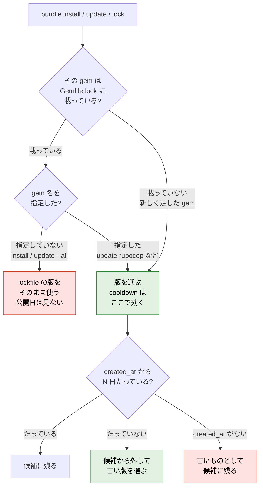

## きっかけ

[前回の記事](https://qiita.com/Nekorock/items/d25fc8cb764c0e9325bc)では、npm・pnpm・Yarn の「公開されたばかりの版は入れない」設定（クールダウン）が、lockfile にすでに入っている版にも効くのかを試しました。止めてくれたのは pnpm だけでした。

Ruby でも、2026 年 6 月 3 日リリースの Bundler 4.0.13 で同じ趣旨の `cooldown` が入りました。自分の Ruby のリポジトリにも入れたので、今回は同じことを Bundler で確かめます。

先に書いておくと、Bundler は lockfile にある版にはクールダウンをかけない、と公式に明言しています。RubyGems のブログには「既存の `Gemfile.lock` は常にそのまま尊重されるので、cooldown を追加しても、すでにロックしている版が乱されることはない」とあります（参考に載せています）。なので「効かない」こと自体は新しい話ではありません。この記事では、それが実際の操作でどう見えるのか、特に `bundle install` を CI で回したときと、`bundle update` したときにどうなるのかを、実在の gem で確かめた結果をまとめます。

## 設定の仕方

指定の仕方は 3 つあります。単位はどれも日です。

```ruby:Gemfile
source "https://rubygems.org", cooldown: 7
```

```bash
bundle config set cooldown 7   # または環境変数 BUNDLE_COOLDOWN=7
bundle install --cooldown 7    # その回だけ
```

優先順位は「コマンドラインの `--cooldown` > `bundle config`（`BUNDLE_COOLDOWN`）> Gemfile の `cooldown:`」です。`0` を渡すとその回は無効になります。手元の Bundler 4.0.23 では、`install`・`update`・`add`・`outdated`・`cache`・`lock` に `--cooldown` があり、ヘルプの説明は次のとおりです。

```text
Only consider gem versions published at least N days ago. Use 0 to disable.
```

`bundle lock` と `bundle cache` の `--cooldown` は少し遅れて 4.0.18 で入りました（2026 年 10 月現在の CHANGELOG による）。

判定には、gem サーバーが compact index（`/info/<gem>`）で返す各版の `created_at` が使われます。rubygems.org では、たとえば rubocop の行の末尾がこうなっています。

```text
1.92.1 json:>= 2.3,...|checksum:a905381a...,ruby:>= 2.7.0,created_at:2026-10-22T05:16:52Z
```

## 試した条件

- 2026 年 10 月 27 日 9 時台（JST）、macOS、Ruby 4.0.9、Bundler 4.0.23
- Gemfile は `gem "rubocop", "~> 1.92"` だけ
- この時点の rubocop は 1.92.1（10 月 22 日公開、4 日前）、その前が 1.92.0（10 月 10 日公開）
- 依存の parser も 3.3.13.0（10 月 23 日公開、3 日前）が出たばかりで、その前は 3.3.12.0（7 月 16 日公開）

日付は rubygems.org の `https://rubygems.org/api/v1/versions/<gem>.json` で確認しました（UTC）。

図にすると、rubocop 1.92.1 と parser 3.3.13.0 が 7 日の範囲に入っています。


## lockfile がないとき

まずはクールダウンなしで `bundle lock` します。

```text
$ bundle lock
Writing lockfile to .../a/Gemfile.lock
Fetching gem metadata from https://rubygems.org/...........
Resolving dependencies...
```

`rubocop (1.92.1)` と `parser (3.3.13.0)` が入りました。最新を取るので当然です。

次に Gemfile の `source` に `cooldown: 7` を付けて、同じことをします。

```text
$ bundle lock
Writing lockfile to .../b/Gemfile.lock
Fetching gem metadata from https://rubygems.org/...........
Resolving dependencies...
The following gem versions were skipped by the cooldown setting:
  * parser 3.3.13.0 (available in 4 days), resolved 3.3.12.0 instead
  * rubocop 1.92.1 (available in 3 days), resolved 1.92.0 instead
```

2 つとも 1 つ前の版に戻り、何を飛ばしたかも出してくれます（この一覧は 4.0.19 で追加されたものです）。`BUNDLE_COOLDOWN=7` で実行しても同じ結果でした。ここまでは期待どおりです。

## lockfile に新しい版がすでに入っているとき

前回と同じ状況を作ります。チームの誰かがクールダウンの設定なしで `bundle lock` して、rubocop 1.92.1 と parser 3.3.13.0 が入った `Gemfile.lock` をコミットした、という想定です。Gemfile のほうには `cooldown: 7` が付いています。

```text
$ bundle install
Fetching gem metadata from https://rubygems.org/...........
...
Fetching parser 3.3.13.0
...
Fetching rubocop 1.92.1
...
Installing parser 3.3.13.0
...
Installing rubocop 1.92.1
Bundle complete! 1 Gemfile dependency, 15 gems now installed.
Bundled gems are installed into `./vendor/bundle`
```

終了コードは 0 で、クールダウンについては警告も何も出ません。

ここまでの 3 つの結果を並べるとこうなります。


CI で使う設定でも試しました。Bundler 4 では `bundle install --frozen` というフラグ自体がなくなっていて、実行すると次のメッセージで終了コード 15 になります。

```text
The `--frozen` flag has been removed because it relied on being remembered
across bundler invocations, which bundler no longer does. Instead please use
`bundle config set frozen true`, and stop using this flag
```

そこで `vendor/bundle` を消してから `BUNDLE_FROZEN=true` で入れ直し、さらにコマンドラインでも `--cooldown 7` を重ねてみました。

```text
$ BUNDLE_FROZEN=true bundle install
…（Fetching / Installing の行は省略）
Bundle complete! 1 Gemfile dependency, 15 gems now installed.
Bundled gems are installed into `./vendor/bundle`

$ BUNDLE_FROZEN=true bundle install --cooldown 7
…（Fetching / Installing の行は省略）
Bundle complete! 1 Gemfile dependency, 15 gems now installed.
Bundled gems are installed into `./vendor/bundle`
```

どちらも 1.92.1 と 3.3.13.0 がそのまま入りました。`bundle lock`（`--update` なし）を実行しても lockfile は 1 行も変わりません。

`bundle outdated` なら何か出るかと思いましたが、rubocop は「今入っているのが最新」なので一覧に出てきません。出たのは、rubocop-ast が `~> 1.7` で縛っているので実際には選ばれない prism 2.0.0 だけでした。

```text
$ bundle outdated
Gem    Current  Latest               Requested  Groups  Release Date
prism  1.9.0    2.0.0 (cooldown 2d)
```

npm の `npm ci` や Yarn の `yarn install --immutable` と同じで、lockfile どおりに入れるときはクールダウンは見られません。pnpm のように lockfile の全エントリを公開日と照らし合わせる動きはありませんでした。

## bundle update すれば戻るのか

ここは少し意外でした。同じ lockfile で、更新系のコマンドをいくつか試した結果です（いずれも Gemfile に `cooldown: 7`）。

| コマンド | rubocop | parser |
| --- | --- | --- |
| `bundle update`（`--all` 扱い） | 1.92.1 のまま | 3.3.13.0 のまま |
| `bundle update --all --cooldown 7` | 1.92.1 のまま | 3.3.13.0 のまま |
| `bundle lock --update` | 1.92.1 のまま | 3.3.13.0 のまま |
| `bundle update rubocop` | 1.92.0 に戻る | 3.3.13.0 のまま |
| `bundle lock --update rubocop parser` | 1.92.0 に戻る | 3.3.12.0 に戻る |

全部まとめて更新しても、新しすぎる版は残ります。戻るのは、コマンドラインで名前を指定した gem だけです。

```text
$ bundle update rubocop
Resolving dependencies...
Resolving dependencies...
Note: rubocop version regressed from 1.92.1 to 1.92.0
Bundle updated!
The following gem versions were skipped by the cooldown setting:
  * rubocop 1.92.1 (available in 3 days), resolved 1.92.0 instead
```

依存として入っている parser のような gem は、自分から名前を挙げない限りそのままです。

## なぜこうなっているのか

Bundler のソース（`lib/bundler/resolver.rb`）を読むと、クールダウンで候補から外すかどうかの判定はこうなっています。

```ruby
def cooldown_excluded?(spec)
  return false unless spec.respond_to?(:created_at) && spec.created_at
  return false unless spec.respond_to?(:remote) && spec.remote
  return false if locked_by_lockfile?(spec)
  days = spec.remote.effective_cooldown
  return false if days.nil? || days <= 0
  (cooldown_now - spec.created_at) < (days * 86_400)
end
```

`created_at` がない版と、lockfile に載っている版は、最初の数行で「外さない」になります。`locked_by_lockfile?` の上のコメントには、cooldown は新しい版を採用するときだけのもので、lockfile がすでに固定している版を取り消してはいけない、ただし `bundle update GEM` で名前を指定された gem は例外、と書かれています。`--all` は名前の指定にあたらないので、上の表の結果になります。

経緯も追ってみました。4.0.13 で cooldown が入った直後に、「cooldown を入れる前に入れた版が lockfile にあると、`bundle update` や `bundle outdated` が失敗する」という報告（[#9598](https://github.com/ruby/rubygems/issues/9598)、[#9613](https://github.com/ruby/rubygems/issues/9613)）が続きました。これに対応したのが [#9599](https://github.com/ruby/rubygems/pull/9599)（4.0.14）と [#9619](https://github.com/ruby/rubygems/pull/9619)（4.0.15）で、#9619 のタイトルは「Exempt lockfile versions from cooldown on every resolution path」です。つまり、lockfile の版を対象外にしているのは見落としではなく、既存のプロジェクトで設定を有効にしたとたんに更新が壊れないようにするための設計です。

設定を入れた日に、新しめの gem を 1 つでも抱えているプロジェクトは珍しくないので、この判断は妥当だと思います。ただ、裏返すと「誰がどうやって lockfile を書いたか」はクールダウンでは保証されない、ということになります。

試した結果とソースから、どこで効いてどこで効かないかを図にするとこうなります。



## ほかに気をつけること

### 古い Bundler は黙って無視する

lockfile を書くのが 4.0.13 より前の Bundler だった場合も試しました。`gem install bundler -v 4.0.12` で入れた 4.0.12 で、`cooldown: 7` 付きの Gemfile を `bundle lock` すると、エラーも警告も出ずに rubocop 1.92.1 と parser 3.3.13.0 が入った lockfile ができました（`BUNDLED WITH` は 4.0.12）。Gemfile に書いておけば全員に効く、とは限りません。

### created_at を返さないサーバー

`bundle config` の man ページには、`created_at` がない版は「クールダウンの範囲外として扱われ、解決できるまま残る」とあり、古い gem サーバー、v1 形式の compact index を返す社内レジストリ、rubygems.org の v2 移行より前の古いエントリが例に挙がっています。

rubygems.org については、rails・activesupport・json・nokogiri・rubocop・thor の `/info/<gem>` を見た範囲では、全部の版に `created_at` が入っていました（2026 年 10 月現在）。社内のミラーやプライベートレジストリを使っている場合は、`curl <サーバー>/info/<gem>` で行末に `created_at:` があるかを一度見ておくのがよさそうです。

## lockfile のほうを CI で見る

npm のときと同じで、lockfile を自分で検査すれば穴は埋まります。やることは単純で、`Gemfile.lock` の各版の公開日を rubygems.org から取って比べるだけです。

```bash
curl -s https://rubygems.org/api/v1/versions/rubocop.json \
  | ruby -rjson -e 'puts JSON.parse(STDIN.read).find { _1["number"] == "1.92.1" }["created_at"]'
# 2026-10-22T05:16:52.909Z
```

これを CI で回すために、自分で [gemlock-guard](https://github.com/OTA-EITA/gemlock-guard) というツールを作って使っています（宣伝になってしまいますが、自作のツールです）。Gemfile と Gemfile.lock をテキストとして読むだけで、`--online` を付けたときだけ rubygems.org に公開日を問い合わせます。上の「誰かが設定なしで書いた lockfile」を検査するとこうなります。

```text
$ gemlock-guard --online c
c/Gemfile.lock:9  MEDIUM GG006  parser@3.3.13.0 was released 3 day(s) ago
c/Gemfile.lock:16  MEDIUM GG006  rubocop@1.92.1 was released 4 day(s) ago

1 project(s), 2 finding(s): 0 high, 2 medium, 0 low
```


終了コードは 1 です。`bundle lock --update rubocop parser` で 2 つとも戻したあとの lockfile では `No problems found.` になりました。

GitHub Actions では、`bundle install` より前に置いています。

```yaml:.github/workflows/ci.yml
  gemlock-guard:
    runs-on: ubuntu-latest
    steps:
      - uses: actions/checkout@v5
        with:
          persist-credentials: false
      - uses: OTA-EITA/gemlock-guard@323a3a7161e1e35b39e0115edd0bf0d3dcfbd90e # v0.1.0
        with:
          online: "true"
          fail-on: medium
```

引っかかった gem は、名前を指定して戻せば Bundler のクールダウンがそのまま効きます。

```bash
bundle update rubocop parser --conservative
```

ツールは何でもよくて、大事なのは前回と同じく「コミットされた lockfile を CI で見る」ことです。あわせて、Dependabot の `cooldown`（bundler に対応しています）を設定しておくと、ボットが新しすぎる版の PR を出してくることも減らせます。

## 7 日で足りるのか

RubyGems で実際にあった乗っ取りを 2 件見てみます。

- rest-client（2019 年 8 月）：メンテナのアカウントが乗っ取られ、バックドア入りの 1.6.10〜1.6.13 が 8 月 13〜14 日に公開されました。8 月 19 日に報告され、同じ日に削除されています（CVE-2019-15224）。公開から 5〜6 日です
- strong_password（2019 年）：乗っ取られたアカウントから 0.0.7 が 6 月 25 日に公開されました（メンテナの説明による）。見つけた Tute Costa さんの記事（7 月 3 日付）によると、6 月 28 日に Rails のセキュリティ担当経由で RubyGems に報告し、すぐに削除されています（CVE-2019-13354）。公開から 3〜4 日です

どちらも 7 日あれば、削除が間に合っていた計算です。ただ、strong_password は、Costa さんが依存を上げる前に差分を見ていて、GitHub に存在しないリリースだと気づいたのがきっかけです。クールダウンは見つけてもらうまでの時間を稼ぐもので、その間に誰かが見ていることが前提だということも覚えておきたいところです。

## おわりに

Bundler のクールダウンは、新しく版を選ぶときには期待どおりに動き、何を飛ばしたかもはっきり出してくれます。一方で、lockfile にある版には `install` でも `update --all` でも手を付けません。これは既存プロジェクトを壊さないための意図した設計なので、Bundler の不具合と考えるより、守備範囲が「解決するとき」に限られていると理解しておくのがよさそうです。

lockfile は、設定のない環境、古い Bundler、ボットなど、いろいろな経路で書き換わります。前回の npm と Yarn と同じく、Bundler でも CI で lockfile 自体を見る仕組みを別に用意しておくのが安心です。

## 参考

- [cooldown: let new gems be vetted（RubyGems Blog, 2026-06-03）](https://blog.rubygems.org/2026/06/03/cooldown-let-new-gems-be-vetted.html)：発表記事。既存の Gemfile.lock はそのまま尊重されると明記
- [Cooldown（RubyGems Guides）](https://guides.rubygems.org/cooldown)、[bundle config](https://bundler.io/v4.0/man/bundle-config.1.html)：設定方法と `created_at` がない版の扱い
- [Add `cooldown` to delay newly published gem（ruby/rubygems#9576）](https://github.com/ruby/rubygems/pull/9576)
- [Exempt lockfile versions from cooldown on every resolution path（ruby/rubygems#9619）](https://github.com/ruby/rubygems/pull/9619)、[#9599](https://github.com/ruby/rubygems/pull/9599)、[#9598](https://github.com/ruby/rubygems/issues/9598)、[#9613](https://github.com/ruby/rubygems/issues/9613)
- [ruby/rubygems CHANGELOG](https://github.com/ruby/rubygems/blob/master/CHANGELOG.md)
- [Ruby's Bundler adds a cooldown feature（LWN.net）](https://lwn.net/Articles/1076526/)
- [min-release-age(cooldown)の設定メモ（@minamijoyo）](https://qiita.com/minamijoyo/items/d43f3be079d518c340ce)：npm などと並べて `BUNDLE_COOLDOWN` の設定を紹介
- [Package managers need to cool down（Andrew Nesbitt）](https://nesbitt.io/2026/03/04/package-managers-need-to-cool-down)
- [Dependabot options reference: cooldown（GitHub Docs）](https://docs.github.com/en/code-security/reference/supply-chain-security/dependabot-options-reference)
- [Version 1.6.13 published with malicious backdoor（rest-client/rest-client#713）](https://github.com/rest-client/rest-client/issues/713)
- [strong_password v0.0.7 rubygem hijacked（Tute Costa）](https://withatwist.dev/strong-password-rubygem-hijacked.html)
