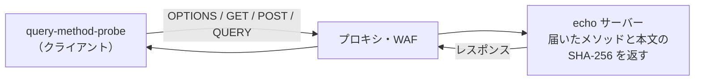

## きっかけ

HTTP の新しいメソッド QUERY が、2026 年 6 月に [RFC 10008](https://www.rfc-editor.org/rfc/rfc10008.html)（Proposed Standard）として公開されました。本文を持てるのに、GET と同じく安全で冪等なメソッドです。検索条件が長くて URL に入りきらず、POST で代用していた API の置き換え先になります。

仕様が決まっても、本番で使えるかは別の話です。クライアントとアプリの間には、リバースプロキシ、WAF、ロードバランサー、サービスメッシュが挟まります。どれか1つが QUERY を知らなければ、そこで止まります。

そこで、リバースプロキシと WAF を Docker で並べて、QUERY が本当に通るかを試しました。検証に使ったツールと環境は [OTA-EITA/query-method-probe](https://github.com/OTA-EITA/query-method-probe) に置いてあり、同じ結果を手元で再現できます。

### 既にある記事との違い

QUERY については、Qiita にすでに良い記事があります。

- 仕様の解説と、FastAPI・Go・Hono で実装してみた記事
  - [【RFC 10008】新HTTPメソッド QUERY 入門 — GETのかゆいところに手が届く / FastAPIで動くのか実際に試した](https://qiita.com/tasekino/items/9d16bb77c5b3c8a16d54)
  - [HTTPに新メソッド「QUERY」が登場 — GETとPOSTの間を埋めるRFC 10008を理解する](https://qiita.com/kazuki_kuriyama/items/fc91fe1b566ab472ad91)
  - [新しいHTTPメソッド「QUERY」をHono + Bunで実装してみる](https://qiita.com/maaaashi/items/6eefccb7361f64607865)
- サーバーとキャッシュの対応状況を実測した記事
  - [QUERYメソッドはどこまで通るのか — nginx / Apache / H2O / Tomcat の対応状況を実測とソースで調べた](https://qiita.com/tasekino/items/1be0eb7ebf983638367c)（2026 年 8 月、nginx 1.24.0）

この記事では、上の記事で扱われていない **WAF（ModSecurity + OWASP CRS）と、HAProxy・Envoy・Traefik・Caddy** を実測します。nginx は最新の 1.30.6 で、先行記事の結果が今も変わっていないかを確かめました。

## 結論

| 経路 | QUERY | 本文 | 補足 |
|---|---|---|---|
| **ModSecurity + OWASP CRS 4.30.0（初期設定）** | **403** | 届かない | 許可するメソッドに QUERY がない |
| ModSecurity + CRS（QUERY を許可に追加） | 通る | 届く | |
| HAProxy 3.4.7 | 通る | 届く | |
| Envoy 1.40.0 | 通る | 届く | 1.40.0 から対応 |
| Traefik 3.7.16 | 通る | 届く | |
| Caddy 2.11.7 | 通る | 届く | |
| nginx 1.30.6 | 通る | 届く | 先行記事（1.24.0）と同じ |
| nginx 1.30.6（`proxy_cache` 有効） | 通る | 届く | QUERY はキャッシュされない |

リバースプロキシは、どれも QUERY を本文ごとそのまま通しました。**止まったのは WAF** です。OWASP CRS を初期設定のまま入れていると、QUERY は 403 で弾かれます。

## 何をどう確かめたか



- 送る順番は、OPTIONS、本文付き GET、POST、QUERY、本文だけを変えた 2 回目の QUERY です。
- 送り先の echo サーバーは、受け取ったメソッド名と本文の SHA-256 を返します。クライアント側で比べて、QUERY のまま届いたか、本文が欠けずに届いたかを判定します。
- 2 回目の QUERY は、キャッシュの確認用です。RFC 10008 の 2.7 節は、QUERY のキャッシュのキーにリクエストの本文を含めることを MUST としています。キャッシュが本文を無視していれば、2 回目にも 1 回目と同じ応答が返るので、それを検出します。
- 本文は `{"q":"x","limit":10}`（`application/json`）です。イメージはすべてダイジェストで固定しています。

```bash
git clone https://github.com/OTA-EITA/query-method-probe
cd query-method-probe
./lab/run.sh   # docker と jq が必要。結果は lab/results/summary.md に出ます
```

自分の環境の URL を調べるときは、CLI だけで使えます。

```bash
go install github.com/OTA-EITA/query-method-probe/cmd/query-method-probe@latest
query-method-probe check https://api.example.com/search \
  --body '{"q":"x"}' --content-type application/json
```

## ハマりどころ

### 1. ModSecurity + OWASP CRS が QUERY を 403 で弾く

- 症状：プロキシを直接叩くと通るのに、WAF を挟むと QUERY だけ 403 になる。OPTIONS と POST は 200 のまま
- 原因：CRS の初期設定で許可されるメソッドは `GET HEAD POST OPTIONS` だけです（`REQUEST-901-INITIALIZATION.conf` の `tx.allowed_methods`）。それ以外のメソッドが来ると、ルール **911100**（Method is not allowed by policy）が異常スコアを加算し、合計が閾値の 5 に達したところでルール **949110** が遮断します。WAF のログにも、QUERY のリクエストに対して 911100 と 949110 が記録されていました
- 対処：許可するメソッドに QUERY を足します。公式の Docker イメージなら環境変数で変えられます

```yaml
  modsecurity:
    image: owasp/modsecurity-crs:4.30.0-nginx-202610180210
    environment:
      ALLOWED_METHODS: GET HEAD POST OPTIONS QUERY
```

CRS を自分で組み込んでいる場合は、`crs-setup.conf` で `tx.allowed_methods` に QUERY を加えます。これで 200 が返り、本文も欠けずに届きました。

クラウドや CDN のマネージド WAF にも、許可するメソッドを決める設定があるものがあります。QUERY を入れる前に、経路上の WAF を一通り確かめておくと安全です。

### 2. 本文付きの GET も WAF で弾かれる

「検索条件を GET の本文に入れればいい」という逃げ道も、WAF で確かめました。本文付きの GET は、初期設定でも、QUERY を許可した後でも 403 でした。CRS のルール **920170**（GET や HEAD に本文があるリクエスト）によるものです。

そもそも [RFC 9110 の 9.3.1 節](https://www.rfc-editor.org/rfc/rfc9110.html#section-9.3.1)では、GET の本文には一般的な意味が定義されていません。中継の途中で落とされても文句は言えないので、本文で条件を渡したいなら QUERY を使うのが正攻法です。

### 3. Envoy は 1.40.0 から

今回の Envoy 1.40.0 では素直に通りましたが、それより前の版は事情が違います。

Envoy 1.40.0 の[変更履歴](https://github.com/envoyproxy/envoy/blob/v1.40.0/changelogs/1.40.0.yaml)によると、HTTP/1 のコーデックが QUERY を認識するようになり、`400`（`HPE_INVALID_METHOD`）で拒否せずに転送するようになりました。HTTP/2 と HTTP/3 にはメソッドの許可リストがなく、以前から転送していたそうです（[envoyproxy/envoy#46496](https://github.com/envoyproxy/envoy/pull/46496)）。

Istio のように Envoy を内部で使うサービスメッシュでは、組み込まれている Envoy の版によって、HTTP/1 の QUERY が 400 になる可能性があります（今回は未検証です）。導入前に、経路上の Envoy の版を確かめておくのが確実です。

### 4. nginx は QUERY をキャッシュできない

ここは[先行記事](https://qiita.com/tasekino/items/1be0eb7ebf983638367c)の nginx 1.24.0 での結果と同じで、1.30.6 でも変わっていませんでした。

- QUERY はキャッシュを有効にしても毎回オリジンまで届き、本文を変えた 2 回目にも正しく新しい応答が返る
- [`proxy_cache_methods`](https://nginx.org/en/docs/http/ngx_http_proxy_module.html#proxy_cache_methods) に書けるのは `GET | HEAD | POST` だけで、QUERY を書くと設定のチェックで起動できない

```text
nginx: [emerg] invalid value "QUERY" in /etc/nginx/query-cache-methods.conf:10
nginx: configuration file /etc/nginx/query-cache-methods.conf test failed
```

RFC 10008 は QUERY の応答をキャッシュしてよいとしていますが、nginx でその効果を得るには対応を待つ必要があります。代わりに POST を本文込みでキャッシュする方法には、本文が大きいとキャッシュのキーが空になって別の応答が返る罠があり、先行記事に詳しくまとめられています。

### 5. ブラウザから呼ぶと CORS のプリフライトが飛ぶ

これは今回の検証環境では試していませんが、RFC 10008 の 4 節に書かれている注意点です。QUERY は CORS で特別扱いされる「安全なメソッド」には入っていないので、ブラウザから別オリジンの API を呼ぶと、必ず OPTIONS のプリフライトが先に飛びます。API 側の CORS の設定で、許可するメソッドに QUERY を足しておく必要があります。

同じ 4 節には、QUERY を使う利点も書かれています。URL は途中の機器のログに残りやすいので、機密を含む検索条件は URL より本文で送るほうがよい場合がある、というものです。

## まとめ

- リバースプロキシ（HAProxy、Envoy 1.40.0、Traefik、Caddy、nginx）は、QUERY を本文ごとそのまま通した
- **WAF（OWASP CRS）は初期設定だと QUERY を 403 で弾く**。許可するメソッドに QUERY を足せば通る
- Envoy は 1.40.0 より前だと、HTTP/1 の QUERY を 400 にする
- nginx は QUERY をキャッシュしない（設定もできない）
- ブラウザから呼ぶなら、CORS で QUERY を許可しておく

QUERY を API に入れるときは、アプリより先に、経路上の WAF の許可するメソッド、サービスメッシュの Envoy の版、CORS の設定を確かめておくと、つまずきを減らせます。

自分の環境の経路でも試せるように、検証に使ったツールを [query-method-probe](https://github.com/OTA-EITA/query-method-probe) として公開しています。

## 参考

- [RFC 10008: The HTTP QUERY Method](https://www.rfc-editor.org/rfc/rfc10008.html)（2.7 節 Caching、4 節 Security Considerations）
- [RFC 9110: HTTP Semantics, 9.3.1 GET](https://www.rfc-editor.org/rfc/rfc9110.html#section-9.3.1)
- [OWASP CRS 4.30.0: REQUEST-911-METHOD-ENFORCEMENT.conf](https://github.com/coreruleset/coreruleset/blob/v4.30.0/rules/REQUEST-911-METHOD-ENFORCEMENT.conf)
- [OWASP CRS 4.30.0: REQUEST-920-PROTOCOL-ENFORCEMENT.conf](https://github.com/coreruleset/coreruleset/blob/v4.30.0/rules/REQUEST-920-PROTOCOL-ENFORCEMENT.conf)
- [nginx: proxy_cache_methods](https://nginx.org/en/docs/http/ngx_http_proxy_module.html#proxy_cache_methods)
- [Envoy 1.40.0 changelog](https://github.com/envoyproxy/envoy/blob/v1.40.0/changelogs/1.40.0.yaml)
- [envoyproxy/envoy#46496: http: add support for the QUERY method (RFC 10008)](https://github.com/envoyproxy/envoy/pull/46496)
- [QUERYメソッドはどこまで通るのか — nginx / Apache / H2O / Tomcat の対応状況を実測とソースで調べた（Qiita）](https://qiita.com/tasekino/items/1be0eb7ebf983638367c)
- [【RFC 10008】新HTTPメソッド QUERY 入門（Qiita）](https://qiita.com/tasekino/items/9d16bb77c5b3c8a16d54)
- [HTTPに新メソッド「QUERY」が登場（Qiita）](https://qiita.com/kazuki_kuriyama/items/fc91fe1b566ab472ad91)
- [新しいHTTPメソッド「QUERY」をHono + Bunで実装してみる（Qiita）](https://qiita.com/maaaashi/items/6eefccb7361f64607865)
- [＠IT: API設計の常識が変わる？ HTTP新メソッド「QUERY」とセキュリティ対策を学ぶ](https://atmarkit.itmedia.co.jp/ait/articles/2607/30/news031.html)
