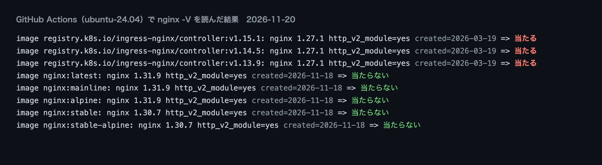

2026 年 3 月に開発を終えた kubernetes/ingress-nginx の最後のコントローラー 3 版 v1.15.1・v1.14.5・v1.13.9 は、どれも nginx 1.27.1 を同梱していました。1.27.1 は、11 月 18 日に修正版が出た HTTP/2 の脆弱性 NGINX2Shell（CVE-2026-123007）が当たる範囲の版です。公式の nginx イメージはその日のうちに修正版へ差し替わりましたが、ingress-nginx にはもう新しい版が出ません。

NGINX2Shell の解説記事はすでにいくつかありますが、この記事では「ingress-nginx を使っているクラスタはどうなるか」に絞ります。GitHub Actions でイメージの中の nginx の版を実際に読んだ結果と、ingress-nginx を使っている人がいまやることをまとめます。

## NGINX2Shell（CVE-2026-123007）のおさらい

nginx.org の security advisories によると、CVE-2026-123007 は HTTP/2 のフロー制御でメモリが壊れる脆弱性で、深刻度は major です。

| 項目 | 内容 |
|---|---|
| 当たる版 | 1.9.5〜1.31.8 |
| 修正版 | 1.31.9 以降（mainline）、1.30.7 以降（stable） |
| 条件 | HTTP/2 を使う設定（F5 の説明による） |
| 同じリリースで直った他の脆弱性 | CVE-2026-123634（resolver）、CVE-2026-121810（HTTP/3）、CVE-2026-123633（HTTP/2）、CVE-2026-118899（TLS 1.3 の無限ループ）、CVE-2026-113425（mail proxy） |

Debian の security tracker に載っている F5 の説明では、細工した通信で worker がクラッシュし、ASLR が無効か回避できる場合はコードの実行につながるとされています。

1.9.5 は ngx_http_v2_module が入った版なので、HTTP/2 を有効にしている nginx はほぼ全部が対象です。

## ingress-nginx はもう直らない

ingress-nginx の README の冒頭は「Ingress NGINX Retirement」に変わっていて、2025 年 11 月 11 日の Kubernetes ブログを引いて次のように書かれています。

> Afterward, there will be no further releases, no bugfixes, and no updates to resolve any security vulnerabilities

GitHub の API で確かめた状態は次のとおりです。

| 項目 | 値 |
|---|---|
| リポジトリ | archived（読み取り専用） |
| 最後の push | 2026-03-23 |
| 最後のコントローラーのリリース | controller-v1.15.1、v1.14.5、v1.13.9（3 つとも 2026-03-19） |
| 同梱の nginx（`images/nginx/rootfs/build.sh` の `NGINX_VERSION`） | 1.27.1 |
| ConfigMap の `use-http2` の既定値 | `"true"` |

NGINX2Shell が出たのは開発終了の 8 か月後です。リポジトリが archived なので、issue を立てることも PR を送ることもできません。

## イメージの中の nginx を実際に読んだ

ソースの `NGINX_VERSION` だけでは、配られているイメージが本当にその版かは分かりません。そこで GitHub Actions の ubuntu-24.04 で、イメージを pull して `nginx -V` の出力を読みました。脆弱性を突く処理は一切していません。

使ったスクリプトはこれだけです（[qiita-articles の samples/nginx2shell-check](https://github.com/OTA-EITA/qiita-articles/tree/main/samples/nginx2shell-check)）。

```bash:check.sh（抜粋）
out=$(docker run --rm --entrypoint sh "$img" -c 'for n in nginx /usr/local/nginx/sbin/nginx /usr/sbin/nginx; do ...; done')
ver=$(grep -o -m1 -E 'nginx/[0-9]+\.[0-9]+\.[0-9]+' <<<"$out" | cut -d/ -f2)
h2=$(grep -q -- '--with-http_v2_module' <<<"$out" && echo yes || echo no)
```

ingress-nginx のイメージは entrypoint が nginx ではないので、`--entrypoint sh` で入って nginx の場所を探しています。版の判定は「1.9.5〜1.31.8 で、1.30.7 以降の 1.30 系ではない」です。

## 結果：ingress-nginx は 3 つとも 1.27.1



| イメージ | nginx | HTTP/2 モジュール | イメージの作成日 | NGINX2Shell |
|---|---|---|---|---|
| ingress-nginx/controller:v1.15.1 | 1.27.1 | あり | 2026-03-19 | **当たる** |
| ingress-nginx/controller:v1.14.5 | 1.27.1 | あり | 2026-03-19 | **当たる** |
| ingress-nginx/controller:v1.13.9 | 1.27.1 | あり | 2026-03-19 | **当たる** |
| nginx:latest / mainline / alpine | 1.31.9 | あり | 2026-11-18 | 当たらない |
| nginx:stable / stable-alpine | 1.30.7 | あり | 2026-11-18 | 当たらない |

ソースのとおり、3 版とも 1.27.1 でした。どの版に上げても逃げられません。

一方、公式の nginx イメージは修正版が出た 11 月 18 日のうちに作り直されていました。`nginx:alpine` のようなタグで使っている人は、pull し直してデプロイし直せば直ります。

## ディストリビューションのパッケージは版番号では判断できない

apt の nginx も同じジョブで確かめました。ディストリビューションは修正を古い版に取り込む（バックポートする）ので、`1.24.0` のような上流の版番号を見ても判断できません。各ディストリビューションのセキュリティ情報と突き合わせました。

| OS | apt の候補（2026-11-20） | セキュリティ情報の修正版 | 判定 |
|---|---|---|---|
| Ubuntu 24.04 | 1.24.0-2ubuntu7.20 | 1.24.0-2ubuntu7.20 | 修正済み |
| Ubuntu 22.04 | 1.18.0-6ubuntu14.23 | 1.18.0-6ubuntu14.23 | 修正済み |
| Debian 13 | 1.26.3-3+deb13u11 | 1.26.3-3+deb13u11（DSA-6642-1） | 修正済み |
| Debian 12 | 1.22.1-9+deb12u10 | まだない（tracker は vulnerable） | **未修正** |

上の check.sh も上流の版番号で判定しているので、apt で入れた nginx には使えません。その場合は `apt list --installed nginx` などで出た版を、上の表の修正版と比べてください。

## 自分たちの環境はどうだったか

自分たちの環境も確かめました。

- 本番の Web サイトは Vercel、API は Go のサーバーを Railway で動かしていて、nginx は使っていない
- 手元の開発用アプリに `FROM nginx:alpine` のフロントエンドが 2 つあった。設定は `listen 80;` だけで HTTP/2 は使っていないが、イメージを作り直しておく
- ingress-nginx を入れたクラスタは自分たちにはない

自分たちのところは無事でした。ただ、ingress-nginx は今もクラスタの入り口によく使われています。開発終了は告知されていましたが、終了後に大きな脆弱性が来ると何が起きるかが、今回はっきりしました。

## ingress-nginx を使っているか確かめる

クラスタの中のコントローラーのイメージを一覧にします。

```bash
kubectl get pods -A -o json \
  | jq -r '.items[] | .metadata.namespace as $ns | .spec.containers[].image | "\($ns)\t\(.)"' \
  | grep ingress-nginx/controller
```

`registry.k8s.io/ingress-nginx/controller` が出てきたら、そのタグを check.sh に渡せば同梱の nginx の版が分かります。なお、NGINX Inc.（F5）の NGINX Ingress Controller は別のプロジェクトで、この記事の対象ではありません。

次に HTTP/2 が有効かを見ます。

```bash
kubectl get configmap -A -o json | jq -r '.items[] | select(.data["use-http2"]) | "\(.metadata.namespace)/\(.metadata.name) use-http2=\(.data["use-http2"])"'
```

何も出なければ既定値の `"true"`、つまり HTTP/2 が有効です。

## いますぐできること：HTTP/2 を止める

CVE-2026-123007 の条件は HTTP/2 を使う設定なので、ConfigMap で HTTP/2 を止めればこの脆弱性の条件からは外れます。

```yaml
apiVersion: v1
kind: ConfigMap
metadata:
  name: ingress-nginx-controller
  namespace: ingress-nginx
data:
  use-http2: "false"
```

代わりに次のことが起きます。

- ブラウザとの通信が HTTP/1.1 になる。多重化がなくなり、ページによっては表示が遅くなる
- gRPC を ingress-nginx 経由で通している場合は通らなくなる。gRPC は HTTP/2 が前提
- 同じリリースで直った CVE-2026-123634（resolver、0.6.18〜）と CVE-2026-118899（TLS 1.3、1.13.0〜）は 1.27.1 も対象で、HTTP/2 と関係がないので、これでは防げない

あくまで移行までのつなぎです。

## 自分でビルドし直すという手もあるが

ingress-nginx のイメージは `images/nginx/rootfs/build.sh` の `NGINX_VERSION` を変えれば、手元で作り直すことはできます。ただし ingress-nginx は nginx にパッチを当て、Lua のモジュールも組み込んでいます。1.27.1 から 1.30.7 へ上げると、それが全部通る保証はありません。誰もメンテナンスしていないビルドを自分たちが持ち続けることになるので、どうしても移行が間に合わない場合の手段だと考えています。

## 本当の対策は移行

ingress-nginx の README は、これから使う人に対して Gateway API の実装を選ぶよう書いています。開発終了は 1 年前に告知されていました。今回の脆弱性は、移行を後回しにしてきたクラスタにとって「期限が来た」という合図だと思います。

移行を決めるときに確かめておくとよいこと:

- 今使っている annotation（rewrite、認証、レート制限など）が移行先でどう書けるか
- 証明書の扱い（cert-manager との連携）
- 移行先のプロジェクトのリリースの頻度と、脆弱性への対応の実績

## やることのチェックリスト

- [ ] `kubectl get pods -A` で `ingress-nginx/controller` を探す
- [ ] 見つかったら `use-http2` を確かめ、すぐに `"false"` にできるか判断する（gRPC を通していないか）
- [ ] 移行先を決め、移行の期日を決める
- [ ] `nginx:*` の公式イメージを使っているものは pull し直してデプロイし直す（11 月 18 日以降のイメージ）
- [ ] apt の nginx は、ディストリビューションのセキュリティ情報の修正版と比べる。Debian 12 は修正待ち
- [ ] ingress-nginx の他にも、開発が終わったコンポーネントがクラスタに残っていないか洗い出す

## 参考

- nginx security advisories https://nginx.org/en/security_advisories.html
- Debian security tracker CVE-2026-123007 https://security-tracker.debian.org/tracker/CVE-2026-123007
- Ubuntu CVE-2026-123007 https://ubuntu.com/security/CVE-2026-123007
- kubernetes/ingress-nginx README https://github.com/kubernetes/ingress-nginx
- Ingress NGINX Retirement: What You Need to Know https://kubernetes.io/blog/2025/11/11/ingress-nginx-retirement/
- 計測に使ったスクリプトとワークフロー https://github.com/OTA-EITA/qiita-articles/tree/main/samples/nginx2shell-check
