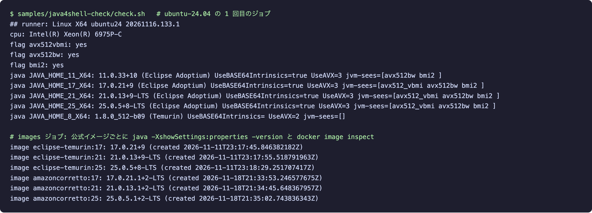

2026 年 11 月 17 日に公開された Java4Shell（CVE-2026-114938）は、Java の版だけでなく **CPU が AVX-512 VBMI を持っているか** で当たるかどうかが決まります。そこで GitHub Actions の x64 の runner を 10 回起動して調べたところ、**7 回で条件がそろっていました**。どの runner にも、最初から修正前の Java 17・21・25 が入っています。公式の Docker イメージも、11 月 19 日の時点で Eclipse Temurin はまだ修正前で、Amazon Corretto は修正済みでした。

Java のアプリを x86 のサーバーやコンテナで動かしている人向けに、当たる条件を修正のソースで確かめた結果と、自分のマシンで 1 分で確かめる方法、修正するまでの回避策をまとめます。

## Java4Shell とは

OpenJDK の HotSpot が、Base64 のデコードを速くするために持っている CPU 向けの専用の処理（intrinsic）の不具合です。細工した Base64 の文字列を渡すと、確保した領域の外へ書き込みます。

OpenJDK の [2026/11/17 の脆弱性勧告](https://openjdk.org/groups/vulnerability/advisories/2026-11-17) では、次のように載っています。

| 項目 | 値 |
|---|---|
| CVE | CVE-2026-114938 |
| 部品 | hotspot/compiler |
| CVSS 3.1 | 8.1 |
| 影響する系統 | 17、21、25、27（8 と 11 は対象外） |

Tenable のまとめによると、発見した Calif は、Keycloak・Jira・Confluence・Jenkins などでログイン前にコードを実行できたとしています。11 月 18 日の時点で GreyNoise が攻撃の試みを観測していますが、成功は確認されていないとのことです（[Tenable FAQ](https://www.tenable.com/blog/java4shell-cve-2026-114938-frequently-asked-questions-about-openjdk-rce-vulnerability)）。

## 当たる条件は 3 つ

修正は [openjdk/jdk の 5177a70](https://github.com/openjdk/jdk/commit/5177a70b38) で入っています。題名は「Base64 optimization improvements」で、脆弱性の修正だとは書かれていません。`src/hotspot/cpu/x86/stubGenerator_x86_64.cpp` を読むと、問題の処理に入る条件が分かります。

```cpp
  // If AVX512 VBMI not supported, just compile non-AVX code
  if(VM_Version::supports_avx512_vbmi() &&
     VM_Version::supports_avx512bw() && VM_Version::supports_bmi2()) {
    __ cmpl(length, 31);     // 32-bytes is break-even for AVX-512
    __ jcc(Assembler::lessEqual, L_lastChunk);

    __ cmpl(isMIME, 0);
    __ jcc(Assembler::notEqual, L_lastChunk);
```

まとめると、次の 3 つがそろったときです。

1. **Java が修正前の 17・21・25・27**
2. **CPU が x86-64 で、AVX-512 VBMI・AVX-512BW・BMI2 の 3 つを持つ**
3. **アプリが、MIME 形式ではない 32 バイト以上の Base64 を、外から受け取ってデコードする**

3 つ目は珍しい条件ではありません。Tenable のまとめでは、Tomcat の Basic 認証や java-jwt が、ログイン前に届く入口になるとされています。arm64 のマシンには、この処理はそもそもありません。

## 修正は 4 行だった

差分はこれだけです。64 バイトずつ処理したあとの端数が 4 バイトに満たないときは、Java 側の普通の処理に回すようにしています。

```diff
     __ BIND(L_finalBit);
     // Now have 1 to 63 bytes left to decode
 
+    // A padded Base64 tail shorter than one complete block is handled by Java.
+    __ cmpl(length, 4);
+    __ jcc(Assembler::less, L_bruteForce);
+
```

## 修正版の番号

Eclipse Temurin の[告知](https://adoptium.net/news/2026/11/temurin-november-2026-cspu-java4shell)に載っている修正版です。Oracle の版も番号は同じです。

| 系統 | 修正版 |
|---|---|
| 17 | 17.0.21.1+2 |
| 21 | 21.0.13.1+2 |
| 25 | 25.0.5.1+2 |
| 27 | 27.0.1.1+4 |
| 8・11 | 対象外 |

10 月に出た 17.0.21・21.0.13・25.0.5 は **修正前** です。版の 4 つ目の数字が 1 になっているかを見ます。

## GitHub Actions の runner で 15 回調べた

自分の CI がどうなっているかを確かめるため、GitHub Actions で次の 3 種類の runner を 5 回ずつ起動しました。

- ubuntu-24.04（x64）
- ubuntu-24.04-arm
- windows-2025（x64）

どれも 2026-11-19 の朝です。調べたのは CPU の機能と、runner に最初から入っている Java の版・フラグだけです。**脆弱性を突く処理は動かしていません**。

使ったスクリプトの要点です（全体は [samples/java4shell-check](https://github.com/OTA-EITA/qiita-articles/tree/main/samples/java4shell-check)）。

```bash
# CPU の機能（Linux）
grep -m1 '^flags' /proc/cpuinfo | grep -ow -E 'avx512vbmi|avx512bw|bmi2'

# Java から見た CPU の機能と、intrinsic が有効か
java -Xlog:os+cpu=info -version 2>&1 | grep -o -E 'avx512_vbmi\b|avx512bw|bmi2' | sort -u
java -XX:+PrintFlagsFinal -version | grep -E ' UseBASE64Intrinsics | UseAVX '
```

Windows の Git Bash では `/proc/cpuinfo` の機能の一覧が実際と合わないことがあったので、判定には Java 自身の見え方（`-Xlog:os+cpu`）を使いました。

1 回目の ubuntu-24.04 の出力と、同じ日に公式の Docker イメージを調べた出力です。



## 結果

| runner | 回数 | CPU | 3 つの命令がそろった回数 | 入っていた Java |
|---|---|---|---|---|
| ubuntu-24.04 | 5 | Xeon 6975P-C ×4、EPYC 7763 ×1 | **4** | 17.0.21+9、21.0.13+9、25.0.5+8 |
| windows-2025 | 5 | EPYC 9V74 ×2、EPYC 9V45 ×1、EPYC 7763 ×2 | **3** | 17.0.21+9、21.0.13+9、25.0.5+8 |
| ubuntu-24.04-arm | 5 | arm64 | 0 | 17.0.21+9、21.0.13+9、25.0.5+8 |

x64 の 10 回のうち 7 回で、3 つの命令がそろっていました。その 7 回ではどれも `UseBASE64Intrinsics=true`、`UseAVX=3` で、入っていた Java 17・21・25 はすべて修正前の版です。つまり、問題の処理が動く状態でした。

## 新しい CPU ほど当たる

そろったのは、Intel の Xeon 6975P-C と、AMD の EPYC 9V74・9V45 でした。EPYC 7763 は AVX-512BW も VBMI も持たず、`UseAVX=2` で問題の処理には入りません。

同じ runner の名前でも、起動するたびに CPU が変わります。5 回のうち何回当たるかは、そのときの割り当て次第です。手元の Mac（Apple M3）や arm の runner のように arm64 なら、そもそも対象外です。

クラウドで「新しい世代のインスタンスに上げたら当たるようになった」ということが起こりえます。版だけを見て「うちは古い CPU だから大丈夫」と決めず、実際に動いているマシンで確かめる必要があります。

## Java 21 からは AVX2 だけでも intrinsic が有効になる

もう 1 つ気づいたことがあります。EPYC 7763 の runner では、Java 11 と 17 は `UseBASE64Intrinsics=false` なのに、21 と 25 は `true` でした。今の OpenJDK の main のソースでは、x86 で `UseAVX >= 2` なら Base64 の intrinsic を有効にします。

```cpp
  // Base64 Intrinsics (Check the condition for which the intrinsic will be active)
  if (UseAVX >= 2) {
    if (FLAG_IS_DEFAULT(UseBASE64Intrinsics)) {
      UseBASE64Intrinsics = true;
    }
```

ただし問題の処理は、その中でも AVX-512 VBMI を持つときだけ使う部分です。`UseBASE64Intrinsics=true` というだけでは当たりません。判定には、CPU の 3 つの命令を必ず合わせて見ます。

## 公式の Docker イメージは配布元で差が出た

同じ日に、公式のイメージの中の Java の版を調べました。

| イメージ | 中の Java | イメージの作成日 | 修正 |
|---|---|---|---|
| eclipse-temurin:17 | 17.0.21+9 | 2026-11-11 | まだ |
| eclipse-temurin:21 | 21.0.13+9 | 2026-11-11 | まだ |
| eclipse-temurin:25 | 25.0.5+8 | 2026-11-11 | まだ |
| amazoncorretto:17 | 17.0.21.1+2 | 2026-11-18 | 済み |
| amazoncorretto:21 | 21.0.13.1+2 | 2026-11-18 | 済み |
| amazoncorretto:25 | 25.0.5.1+2 | 2026-11-18 | 済み |

Temurin はバイナリを出していて、告知にも「すべてのバイナリがそろってからコンテナイメージを出す」と書かれています。2026-11-19 10:25（日本時間）の時点で、Docker Hub の `eclipse-temurin:21` などのタグは 11 月 16 日に更新されたのが最後で、`21.0.13.1` のタグはまだありませんでした。

`FROM eclipse-temurin:21` で作っているイメージは、今ビルドし直しても修正前の Java が入ります。イメージができるまでは、次の回避策を入れておく必要があります。

## 修正するまでの回避策

Temurin の告知が案内しているのは、起動オプションで Base64 の intrinsic を止める方法です。

```bash
java -XX:-UseBASE64Intrinsics -jar app.jar
```

コンテナなら、環境変数でまとめて渡せます。

```dockerfile
ENV JAVA_TOOL_OPTIONS="-XX:-UseBASE64Intrinsics"
```

`JAVA_TOOL_OPTIONS` は、すでにほかの値を入れている場合は上書きにならないよう足してください。付いたかは `java -XX:+PrintFlagsFinal -version | grep UseBASE64Intrinsics` が `false` になることで確かめます。

Tenable のまとめでは、Calif が `-XX:UseAVX=2` でも問題の処理を避けられるとしています。ただし x86-64 だけの指定で、arm の Java はこの指定があると起動しないそうです。arm と x86 が混ざる環境では、`-XX:-UseBASE64Intrinsics` のほうが扱いやすいです。

どちらも Base64 のデコードが少し遅くなります。直ったら外します。

## 自分の環境で確かめる

動いているマシンで、次の 3 つを見ます。

```bash
# 1. Java の版（17・21・25・27 で、4 つ目の数字が 1 未満なら修正前）
java -version

# 2. Java から見た CPU の機能（3 つそろうと対象）
java -Xlog:os+cpu=info -version 2>&1 | grep -o -E 'avx512_vbmi\b|avx512bw|bmi2' | sort -u

# 3. 回避策が効いているか
java -XX:+PrintFlagsFinal -version | grep -E ' UseBASE64Intrinsics '
```

コンテナの中なら、`docker exec` で同じコマンドを動かします。コンテナはホストの CPU をそのまま使うので、同じイメージでも、どのホストに載ったかで結果が変わります。

## やること

- [ ] 外から Base64 を受け取る Java のサービスを洗い出す（JWT・Basic 認証・API のペイロード）
- [ ] 動いているマシンで、上の 3 つのコマンドを流す
- [ ] 修正版（17.0.21.1・21.0.13.1・25.0.5.1・27.0.1.1）に上げる
- [ ] 上げられないものと、修正版のイメージがまだない Temurin のコンテナには `-XX:-UseBASE64Intrinsics` を付ける
- [ ] Dockerfile の `FROM` を、修正版のタグが出たらそれに固定してビルドし直す
- [ ] CI の runner に入っている Java は修正前のままなので、テストで外部の Base64 を扱うなら `actions/setup-java` で修正版を入れる

## 確かめていないこと

- 問題の処理を実際に動かすテストはしていません。調べたのは、条件がそろっているかだけです
- runner の CPU の割り当ては、日や地域で変わるはずです。10 回中 7 回は、2026-11-19 の朝の結果です
- AWS・GCP・Azure のどのインスタンスが当たるかは、自分では確かめていません

## 参考

- [OpenJDK Vulnerability Advisory: 2026/11/17](https://openjdk.org/groups/vulnerability/advisories/2026-11-17)
- [openjdk/jdk 5177a70b38: 8393212: Base64 optimization improvements](https://github.com/openjdk/jdk/commit/5177a70b38)
- [Adoptium: Temurin November 2026 CSPU (Java4Shell)](https://adoptium.net/news/2026/11/temurin-november-2026-cspu-java4shell)
- [Tenable: Java4Shell (CVE-2026-114938) FAQ](https://www.tenable.com/blog/java4shell-cve-2026-114938-frequently-asked-questions-about-openjdk-rce-vulnerability)
- [調べたときの GitHub Actions の実行結果](https://github.com/OTA-EITA/qiita-articles/actions/runs/44436593398)
