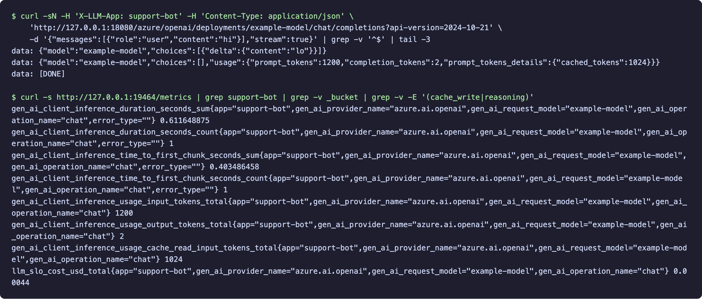

LLM の API 呼び出しを、ほかの外部 API と同じように SLO とエラーバジェットで見るための小さなプロキシ [llm-slo](https://github.com/OTA-EITA/llm-slo) を作りました。作っている途中で、OpenAI・Anthropic・Gemini で「入力トークン」に含まれるものが違うこと、OpenAI のストリームは頼まないと使用量を返さないこと、Prometheus 3 ではヒストグラムの `le="2"` が `le="2.0"` に変わってアラートが黙ること、の 3 つにぶつかりました。

LLM を使う機能を本番で動かしていて「落ちていないか、遅くないか、いくらかかっているか」をアプリごとに Prometheus で見たい人向けです。自分で計測を組む場合にも、この 3 つは同じように踏むはずなので、確かめた結果を表にしました。

## 作ったもの

アプリと LLM の API の間に挟むプロキシです。

```
アプリ ──► llm-slo ──► Azure OpenAI / OpenAI / Anthropic / Vertex AI (Gemini) / OpenAI 互換サーバー
              │
              └──► /metrics ──► Prometheus ──► Grafana, Alertmanager
```

- アプリのコードは、SDK の接続先を変えて、アプリ名のヘッダーを 1 つ足すだけです
- リクエストとレスポンスはそのまま通します。ストリームも届いたそばから流します
- 読むのはモデル名と使用量だけで、プロンプトと応答の本文は保存も記録もしません
- Go の標準ライブラリだけで書いた 1 バイナリです

Azure OpenAI に Python SDK でつなぐ場合は、接続先をプロキシに向けてヘッダーを足します。API キーはそのまま上流に渡り、`X-LLM-App` ヘッダーはプロキシで外してから送ります。

```python
from openai import AzureOpenAI

client = AzureOpenAI(
    azure_endpoint="http://llm-slo:8080/azure",
    api_key=os.environ["AZURE_OPENAI_API_KEY"],
    api_version="2024-10-21",
    default_headers={"X-LLM-App": "support-bot"},
)
```

設定は JSON です。上流、モデルごとの価格、SLO、1 日の予算を書きます。

```json
{
  "upstreams": [
    { "prefix": "/azure", "url": "https://YOUR-RESOURCE.openai.azure.com",
      "api": "openai", "provider": "azure.ai.openai", "inject_stream_usage": true }
  ],
  "prices": {
    "example-model": { "input_per_mtok": 1.0, "output_per_mtok": 4.0, "cache_read_per_mtok": 0.25 }
  },
  "slos": [
    { "name": "support-bot-availability", "kind": "availability", "objective": 0.995, "app": "support-bot" },
    { "name": "support-bot-first-chunk", "kind": "time_to_first_chunk", "objective": 0.95, "threshold_seconds": 2, "app": "support-bot" }
  ],
  "budgets": [ { "app": "support-bot", "usd_per_day": 30 } ]
}
```

価格はツールに入れていません。各社の料金表から自分で書き写す前提で、出てくるコストはあくまで見積もりです。

## 1 回呼ぶと何が残るか

手元に OpenAI 互換の偽の上流を立てて、ストリームで 1 回呼んだときの出力です。上流は、中身のない最初のイベントを返してから 0.4 秒待ち、そのあと本文と使用量を返すようにしてあります。



入力 1,200 トークンのうち 1,024 がキャッシュから読まれ、出力は 2 トークンでした。コストは、キャッシュでない 176 トークン × 1 ドル、キャッシュの 1,024 トークン × 0.25 ドル、出力 2 トークン × 4 ドルを 100 万で割った 0.00044 ドルで、手計算と合っています。最初の 1 文字までの時間は 0.403 秒で、上流で待たせた 0.4 秒とほぼ同じです。

メトリクスの名前は OpenTelemetry の生成 AI 向けの決まりに合わせ、Prometheus の書き方に直しました。

| メトリクス | 中身 |
|---|---|
| `gen_ai_client_inference_duration_seconds` | リクエストが届いてから応答の最後の 1 バイトまで |
| `gen_ai_client_inference_time_to_first_chunk_seconds` | ストリームで、最初に中身のあるイベントが届くまで |
| `gen_ai_client_inference_usage_input_tokens_total` | 入力トークン（キャッシュ分を含む） |
| `gen_ai_client_inference_usage_output_tokens_total` | 出力トークン（推論分を含む） |
| `gen_ai_client_inference_usage_cache_read_input_tokens_total` | キャッシュから読んだ入力トークン |
| `llm_slo_cost_usd_total` | 設定した価格から出したコスト |
| `llm_slo_usage_missing_total` | 成功したのに使用量が返ってこなかった呼び出し |

ラベルは `app`、`gen_ai_provider_name`、`gen_ai_request_model`、`gen_ai_operation_name` と、ヒストグラムにだけ `error_type` です。`app` とモデル名はクライアントが決める値なので、種類の数に上限を付け、超えた分は `_other` にまとめています。

## 3 社で「入力トークン」の中身が違った

一番時間を使ったのがここです。OpenTelemetry の決まりでは、入力トークンは「キャッシュ分を含む」、出力トークンは「推論分を含む」と書かれています。各社の API の公式文書を読むと、それぞれ数え方が違いました。

| | 返ってくる値 | キャッシュ分 | 推論分 | 決まりに合わせるには |
|---|---|---|---|---|
| OpenAI / Azure OpenAI | `prompt_tokens`、`completion_tokens` | `prompt_tokens` に含まれる | `completion_tokens` に含まれる | そのまま |
| Anthropic | `input_tokens`、`output_tokens` | **`input_tokens` に含まれない** | `output_tokens` に含まれる | `input_tokens` + `cache_read_input_tokens` + `cache_creation_input_tokens` |
| Gemini / Vertex AI | `promptTokenCount`、`candidatesTokenCount` | `promptTokenCount` に含まれる | **`candidatesTokenCount` に含まれない** | 出力 = `candidatesTokenCount` + `thoughtsTokenCount` |

Anthropic の文書には、`input_tokens` は最後のキャッシュの区切りより後ろのトークンだけで、合計は `cache_read_input_tokens + cache_creation_input_tokens + input_tokens` だと書いてあります。キャッシュがよく当たっている呼び出しほど、`input_tokens` だけを見ると入力が小さく見えます。最後の区切りの後ろが短い呼び出しなら、キャッシュ込みで 10 万トークン読んでいても、`input_tokens` は数十になりえます。

Gemini は逆で、考える過程のトークン（`thoughtsTokenCount`）が出力とは別に返ってきます。Gemini の文書の料金の説明にも、思考を有効にすると出力トークンと思考トークンの合計で料金がかかる、と書かれています。推論するモデルでは、`candidatesTokenCount` だけを出力として集計すると出力が少なく出ます。

3 社をまたいでアプリごとの使用量を並べるなら、どちらかに寄せないと比べられません。llm-slo では決まりのほうに寄せ、キャッシュ分と推論分は別のメトリクスにも出しています。コストは「キャッシュでない入力」「キャッシュの読み取り」「キャッシュへの書き込み」「出力」に分けて、それぞれの単価を掛けています。

## OpenAI のストリームは、頼まないと使用量を返さない

OpenAI 互換の API でストリームを使うと、何も指定しなければ使用量が返ってきません。リクエストに `stream_options.include_usage: true` を付けると、`[DONE]` の直前に、`choices` が空で `usage` だけが入ったチャンクが 1 つ増えます。上の画像の 2 つ目の `data:` の行がそれです。

チャットの画面はストリームで作ることが多いので、ここを取りこぼすと、ストリームで呼んだ分のトークン数がまるごと抜け落ちます。llm-slo では `inject_stream_usage` を有効にすると、ストリームのリクエストでクライアントが指定していないときだけ、この項目をプロキシが足します。クライアントが自分で `false` にしていれば触りません。

1 つ気をつけることがあります。増える最後のチャンクは `choices` が空です。チャンクごとに `choices[0]` を読む古い自前のコードは、ここで落ちるかもしれません。使用量が取れなかった呼び出しは `llm_slo_usage_missing_total` に数えるので、ここが 0 であることを確かめれば取りこぼしに気づけます。

## 「最初の 1 文字」をどう測るか

チャットの画面で利用者が感じる遅さは、全部返し終わるまでの時間より、最初の文字が出るまでの時間です。ここは SLO を分けて持たせたいところです。

測り方で迷ったのは、何を「最初」とするかでした。OpenAI のストリームは、たいてい最初に `{"delta":{"role":"assistant","content":""}}` という中身のないイベントを返します。これを最初とすると、上流がすぐ返すので速く見えてしまいます。

OpenTelemetry の決まりには、この点がはっきり書いてありました。テキスト、ツール呼び出し、拒否、推論のどれかの中身を持つイベントだけを「チャンク」として数え、役割だけ、使用量だけ、終わりの印、キープアライブは数えない、という定義です。llm-slo もこの定義に合わせ、各社のイベントごとに中身があるかを見ています。

| | 最初のチャンクとして数えるイベント |
|---|---|
| OpenAI Chat Completions | `delta` の `content`、`refusal`、`reasoning_content`、`tool_calls` のどれかが空でない |
| OpenAI Responses API | `type` が `.delta` で終わり、`delta` が空でない |
| Anthropic | `content_block_delta` の `text`、`partial_json`、`thinking` が空でない、またはツール名を持つ `content_block_start` |
| Gemini | `parts` の `text`、`functionCall`、`inlineData` のどれかがある |

上の実行では、中身のない最初のイベントはすぐ返り、本文は 0.4 秒後に届いています。記録は 0.403 秒なので、中身のないイベントは数えていないことが分かります。

## SLO からアラートを作る

`llm-slo rules` で、設定の SLO から Prometheus のルールを作ります。中身は Google の SRE Workbook の「Alerting on SLOs」の章にある、長い窓と短い窓を組み合わせたバーンレートのアラートです。

| アラート | 長い窓と短い窓 | 消費の速さ | 重さ |
|---|---|---|---|
| `LLMSLOBurnRatePage` | 1 時間と 5 分 | 14.4 倍 | page |
| `LLMSLOBurnRatePage` | 6 時間と 30 分 | 6 倍 | page |
| `LLMSLOBurnRateTicket` | 1 日と 2 時間 | 3 倍 | ticket |
| `LLMSLOBurnRateTicket` | 3 日と 6 時間 | 1 倍 | ticket |

目標 99.5% の可用性の SLO から作ったルールの一部です。

```yaml
      - alert: LLMSLOBurnRatePage
        expr: |
          llm_slo:error_ratio:rate1h{slo="support-bot-availability"} > 0.072
          and
          llm_slo:error_ratio:rate5m{slo="support-bot-availability"} > 0.072
        labels:
          severity: page
          slo: support-bot-availability
          long_window: 1h
```

何を失敗に数えるかは、LLM ならではの判断が要りました。

| `error_type` | 中身 | 可用性の失敗に数えるか |
|---|---|---|
| `500`、`503` など | 提供元のエラー | 数える |
| `429` | 流量制限 | 数える |
| `408`、`timeout` | 時間切れ | 数える |
| `incomplete` | 応答が途中で切れた | 数える |
| `400`、`401` など | クライアント側の誤り | 数えない |
| `client_closed` | 呼び出し側が途中で切った | 数えない（分母からも外す） |

`429` を数えるかは迷いましたが、アプリから見れば答えが返ってこないことに変わりはないので、失敗に入れました。逆に、利用者が生成の途中で画面を閉じた場合は提供元のせいではないので、分母からも外しています。分母に入れたままだと、閉じられた分だけ失敗率が実際より低く見えます。

コストの予算からは 2 つのアラートを作ります。直近 24 時間の支出が予算を超えたときと、直近 1 時間の使い方を 1 日続けると予算を超えるペースのときです。後者は 15 分続いたら鳴らします。

## Prometheus 3 で le="2" が当たらなくなる

レイテンシの SLO は、ヒストグラムの「しきい値のバケット」に入った数を全体で割って出します。しきい値 2 秒なら、`le="2"` のバケットを選ぶ式を書くことになります。

ところが Prometheus 3 の移行ガイドには、クラシックなヒストグラムの `le` ラベルの値を取り込むときに浮動小数の形にそろえる、と書かれています。テキスト形式で `le="1"` と出しても、保存されるのは `le="1.0"` です。Prometheus 2 ではスクレイプの方式によって `"1"` のままだったり `"1.0"` になったりしていて、それを直すための変更です。

困るのは、`le="2"` と書いた式がエラーにならず、ただ何も選ばなくなることです。レイテンシの SLO の式が空になると、アラートは鳴りません。そこで、しきい値が整数のときは両方に当たる正規表現にしました。

```yaml
            sum(rate(gen_ai_client_inference_time_to_first_chunk_seconds_bucket{app="support-bot",error_type="",le=~"2|2\\.0"}[5m]))
```

しきい値が `1.5` のように小数なら、どちらのバージョンでも `"1.5"` のままなので、そのまま書いています。もう 1 つ、しきい値がバケットの境目と一致していないと、この式はそもそも成り立ちません。そのため、SLO に書いた `threshold_seconds` はすべてヒストグラムの境目に足しています。

## promtool でアラートが鳴るかまで試す

作ったルールは、`promtool check rules` で文法を確かめるだけでなく、`promtool test rules` で偽の時系列を流して、どのアラートが鳴るかまで確かめています。テストのデータは次のとおりです。

- 1 分あたり成功 100 件と `503` が 50 件
- 呼び出し側が切った分が 1 分あたり 1,000 件
- 成功のうち 80 件が 5 秒以内で、バケットは Prometheus 3 の形の `le="5.0"` で入れる
- コストは 1 分あたり 1 ドル

これで次の 4 点を確かめています。

- 可用性の失敗率が 50 / 150 = 0.333 になること。切った分の 1,000 件が分母に入っていないことの確認です
- レイテンシの失敗率が 0.2 になること。`le="5.0"` を正規表現で拾えていることの確認です
- 鳴るアラートと鳴らないアラートが表のとおりであること
- 予算のペースのアラートが、超えてすぐではなく、続いたあとで鳴ること

```
=== RUN   TestPromtoolCheck
--- PASS: TestPromtoolCheck (0.04s)
=== RUN   TestPromtoolUnit
--- PASS: TestPromtoolUnit (0.12s)
PASS
```

GitHub Actions でも promtool 3.16.0 を入れて同じテストを流しています。式を書き換えたときに、アラートが黙ってしまう変更を CI で止められます。

## OpenTelemetry の名前は 11 月時点で変わっていた

メトリクスの名前を決めるときに、OpenTelemetry の決まりを原文で読みに行ったところ、生成 AI の部分が `semantic-conventions` のリポジトリから `semantic-conventions-genai` という別のリポジトリに移っていました。元のページには「Moved」とだけ書かれています。

名前も変わっていました。以前のトークン数のメトリクスは `gen_ai.client.token.usage` に `gen_ai.token.type` で入力と出力を分ける形でした。今は `gen_ai.client.inference.usage.input_tokens` と `output_tokens` に分かれ、キャッシュと推論も別の名前になっています。最初のチャンクまでの時間は、クライアント側では `gen_ai.client.inference.time_to_first_chunk` という名前になっています。どれも状態は Development で、これからも変わりえます。

移動前の名前のまま書かれた資料もまだあるので、名前を決めるときは移動先のリポジトリを直接見るのが確実です。llm-slo の README には、どの時点の名前に合わせたかを書いています。

## できないこと

- AWS Bedrock の SigV4 署名つきの呼び出しは通せません。署名にはホスト名が含まれていて、プロキシはクライアントが署名したのとは別のホストに送るからです。OpenAI 互換のゲートウェイを経由した Bedrock なら、ほかの OpenAI 互換の上流と同じように測れます
- Gemini の `streamGenerateContent` は、`alt=sse` を付けたときだけ最初のチャンクまでの時間を測れます。付けないと応答が JSON の配列になり、使用量は読めますが、時間は記録しません
- カウンタはメモリにあるだけなので、再起動すると 0 から数え直します。`rate()` と `increase()` はこれを前提にしているので、集計には影響しません
- コストは設定した価格から出す見積もりです。割引、バッチの料金、確保したスループットの料金、税は入っていません

LiteLLM や Langfuse のように、振り分けや、エージェントの実行全体の追跡、プロンプトの管理までできる道具はほかにあります。llm-slo がやるのは、Prometheus と Alertmanager をすでに使っているチームが、LLM の呼び出しをほかの依存先と同じように SLO で見る、ということだけです。

## 自分で計測を組むときに確かめること

llm-slo を使わずに計測を組む場合も、次の点は同じように効いてきます。

- [ ] Anthropic の入力トークンに、`cache_read_input_tokens` と `cache_creation_input_tokens` を足しているか
- [ ] Gemini の出力トークンに `thoughtsTokenCount` を足しているか
- [ ] OpenAI 互換のストリームで `stream_options.include_usage` を付けているか。使用量が 0 の呼び出しを数えているか
- [ ] 最初のチャンクまでの時間で、中身のないイベントを数えていないか
- [ ] 呼び出し側が途中で切った分を、失敗率の分母から外しているか
- [ ] Prometheus 3 で、整数の `le` を指定した式が空になっていないか
- [ ] SLO のしきい値が、ヒストグラムのバケットの境目と一致しているか
- [ ] メトリクスの名前を、`semantic-conventions-genai` の今の版で確かめたか

コードと設定の例、Grafana のダッシュボードは [GitHub](https://github.com/OTA-EITA/llm-slo) にあります。

## 参考

- [OpenTelemetry semantic-conventions-genai: Client Inference](https://github.com/open-telemetry/semantic-conventions-genai/blob/main/docs/gen-ai/client-inference.md)
- [OpenTelemetry semantic-conventions-genai: Gen AI attributes](https://github.com/open-telemetry/semantic-conventions-genai/blob/main/docs/registry/attributes/gen-ai.md)
- [Anthropic: Prompt caching](https://docs.anthropic.com/en/docs/build-with-claude/prompt-caching)
- [Anthropic: Streaming Messages](https://docs.anthropic.com/en/docs/build-with-claude/streaming)
- [Gemini API: Generating content（UsageMetadata）](https://ai.google.dev/api/generate-content)
- [Gemini API: Thinking（Pricing）](https://ai.google.dev/gemini-api/docs/thinking)
- [OpenAI API: Chat Completions の stream_options](https://platform.openai.com/docs/api-reference/chat/create)
- [Prometheus 3 migration guide: le and quantile label values](https://prometheus.io/docs/prometheus/latest/migration/)
- [Google SRE Workbook: Alerting on SLOs](https://sre.google/workbook/alerting-on-slos/)
