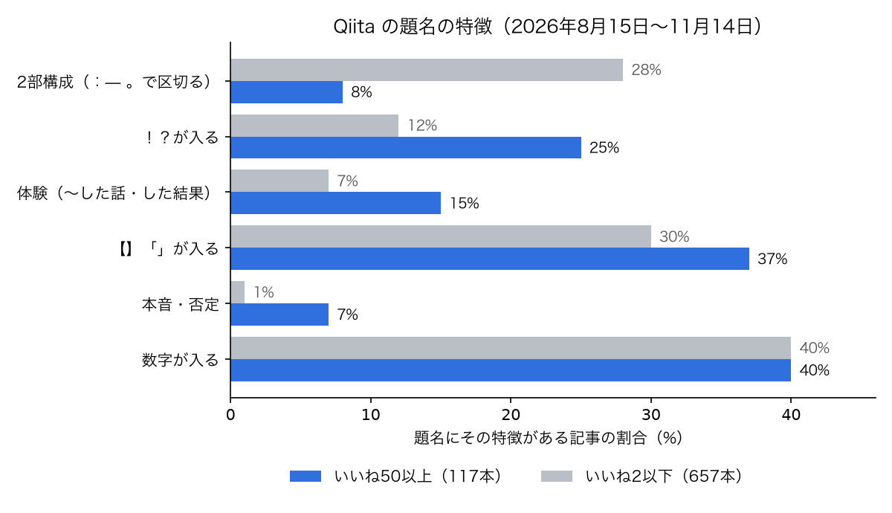

Qiita で、いいねが 50 以上ついた記事 117 本と、2 以下だった記事 657 本の題名を比べました。割合の差が一番大きかったのは、題名を「。」や「：」で 2 つに区切っているかどうかでした。伸びた記事では 8%、伸びなかった記事では 28% です。

きっかけは自分の記事です。10 月から 19 本書いて、いいねはどれも 0〜2 でした。内容には手をかけたつもりだったので、何が違うのかを数字で見たくなりました。

この記事では、集め方と結果、それを見て自分の記事の題名をどう変えたかを書きます。題名で迷っている人の判断材料になればと思います。

## 自分の記事の題名

先に、伸びなかった自分の題名を並べます。

| 題名 | 字数 | いいね |
| --- | --- | --- |
| Laravel 13 の APP_DEBUG=true は Cookie・本文・SQL を伏せずに出す。本番に残りやすい 4 つの設定を動かして確かめた | 76 | 1 |
| 壊れた決済イベント 1 件で、後ろの不正な決済はどうなるのか。Kinesis + Lambda のリトライ設定を LocalStack で比べた | 72 | 0 |
| OpenSSH on musl のパスワード認証バイパス（*sshole）を、musl と OpenSSH のソースで確かめた。CVE はまだ振られていない | 78 | 0 |

どれも「何を確かめたか」と「何が分かったか」を全部題名に入れて、「。」でつないでいます。正確に書こうとして、こうなっていました。

## 集め方

Qiita API v2 の `GET /api/v2/items` を、認証なしで使いました。認証なしだと 1 時間に 60 回までです。

| 組 | 条件 | 本数 |
| --- | --- | --- |
| 伸びた | 2026-08-17〜11-13 に作成、ストック 20 超のうち、いいね 50 以上 | 117 |
| 伸びなかった | 2026-10-30〜11-11 のうち 2 日おきの 7 日分、各日 100 件まで取って、いいね 2 以下 | 657 |

`likes:>=30` のような、いいねで絞る検索条件は、この API では結果が 0 件になりました。そこで、ストックで多めに集めてから、手元でいいねを絞っています。

検索結果は新しい順に並ぶので、期間を指定しても最初の数ページだけ取ると、直近の 1 日分に偏ります。最初はそれに気づかず、伸びなかった側が全部水曜日の記事になっていました。1 日ずつ期間を区切り、2 日おきに取り直しています。いいねは 2026 年 11 月 14 日に取った値です。

```python
for k in range(0, 14, 2):
    a = (today - timedelta(days=k + 3)).isoformat()
    b = (today - timedelta(days=k + 2)).isoformat()
    lo += [i for i in get(f"created:>={a} created:<{b}", 1) if i["likes_count"] <= 2]
```

題名の特徴は、正規表現で判定しました。

```python
PAT = {
    "体験（した話・した結果）": r"た話|話$|した結果|やってみた|してみた",
    "数字が入る": r"\d",
    "【】「」で強調": r"[【「]",
    "！？で感情": r"[！!？?]",
    "否定・本音": r"ない$|たくない|やめた|不要|辞めた|無理|しんどい",
    "2 部構成": r"[:：—―]|。.",
}
```

「2 部構成」は、題名の途中に `：` `—` があるか、「。」のあとにまだ文字が続くものです。

## 結果



| 見たところ | いいね 50 以上 | いいね 2 以下 |
| --- | --- | --- |
| 題名の長さ（中央値） | 34 字 | 41 字 |
| 2 部構成の題名 | 8% | 28% |
| 体験の題名（〜した話・した結果） | 15% | 7% |
| 「！」「？」が入る | 25% | 12% |
| 本音・否定（やめた・不要 など） | 7% | 1% |
| 【】「」が入る | 37% | 30% |
| 数字が入る | 40% | 40% |
| 本文の長さ（中央値） | 約 7,300 字 | 約 4,900 字 |
| 見出しの数（中央値、コードの中を除く） | 13 | 10 |
| 画像の数（中央値） | 1 | 0 |
| 組織アカウントからの投稿 | 43% | 5% |

差は 2 部構成が 20 ポイントで、比べた特徴の中で一番大きくなりました。倍率だけなら本音・否定（7% と 1%）のほうが大きいのですが、使っている記事がそもそも少ないので、ここでは差の大きさで見ています。題名が 40 字を超える記事も、伸びなかった側は 52%、伸びた側は 35% です。

一方で、数字が入っているかどうかは、どちらも 40% で差がありませんでした。「数字を入れると伸びる」とよく聞きますが、この集め方では、数字があるだけでは効いていません。伸びた記事の数字は、「ベテランエンジニアのPRレビュー187件を分類してみたら、バグは5件に1件しか指摘されていなかった」のように、数字そのものが意外なものでした。

## 組織アカウントの影響を外しても差は残った

伸びた記事の 43% は組織アカウントからの投稿でした。フォロワーの多さで伸びているだけかもしれないので、個人の投稿だけで比べ直しました。

| 個人の投稿だけ | いいね 50 以上（67 本） | いいね 2 以下（626 本） |
| --- | --- | --- |
| 2 部構成の題名 | 7% | 28% |
| 題名の長さ（中央値） | 36 字 | 41 字 |

差はほぼそのまま残りました。

## 伸びた記事の題材

いいねの多い順に上から題名を読んでいくと、題材はおおむね次の 6 つの型に当てはまりました。117 本を 1 本ずつ分類して数えたわけではないので、割合は出していません。

| 型 | 例 |
| --- | --- |
| 自分の体験と、そこで分かったこと | 「最近どう？」しか聞けなかった1on1で、メンバーが退職届を出してきた話 |
| 集めて分類・比較した | ベテランエンジニアのPRレビュー187件を分類してみたら、バグは5件に1件しか指摘されていなかった |
| 作った物の紹介 | 個人開発で月17万稼いでみたので生々しいスクショとともに振り返る |
| 事件・障害の当事者の記録 | PHP脆弱性php2shell対応、7.4本番を止めずに守った夜と実際の攻撃 |
| 出たばかりのものの入門 | 5分でJev入門（すぐ使う） |
| すぐ使える一覧 | 最近取り入れたClaude Codeの個人的tips 4選 |

自分の記事は、脆弱性や設定を「一次情報で確かめた」解説がほとんどでした。中身は検証ですが、題名からは自分が何をして、何に困ったのかが見えません。

タグは、伸びた記事では AI、ClaudeCode、生成AI、初心者、Security の順に多くありました。割合で見ると、AI は伸びた記事の 28%・伸びなかった記事の 13%、Security は 12% と 5% で、どちらも伸びた側に多く付いています。ただし本数で見ると、伸びなかった側にも AI は 87 本あり、付ければ伸びるとは言えません。

## 自分の記事の題名をこう変えた

結果を見て、公開済みの 4 本の題名を、中身を変えずに短くしました。

| 前 | 後 |
| --- | --- |
| Laravel 13 の APP_DEBUG=true は Cookie・本文・SQL を伏せずに出す。本番に残りやすい 4 つの設定を動かして確かめた | Laravel 13 の APP_DEBUG=true を本番に残すと、Cookie も SQL も伏せずに出る |
| 壊れた決済イベント 1 件で、後ろの不正な決済はどうなるのか。Kinesis + Lambda のリトライ設定を LocalStack で比べた | 壊れたイベント 1 件で、Kinesis + Lambda の後ろの決済はどうなるか |
| AI セルフホスト 5 製品を公式 compose で立てた直後、最初に来た人が管理者になれたのは n8n と Open WebUI だった | n8n と Open WebUI は、立てた直後なら最初に来た人が管理者になれる |
| Claude Code の「Yes, and don't ask again」はパスワードごと設定に残る。自分のマシンで少なくとも 74 件見つかった | Claude Code の「don't ask again」で、パスワードが設定ファイルに残っていた。手元だけで 74 件以上 |

決めたのは次の 3 つです。

- 1 文にする。検証した条件や補足は本文の冒頭に回す
- 製品名や画面の文言は、検索されるので原文のまま残す
- 本文で確かめた範囲を超える言い方はしない

それでも、まだ 40 字を超えているものがあります。1 週間後に、変える前と後のいいね・閲覧数を比べて、この記事に追記します。

## 書く前に点検するスクリプト

毎回目で数えるのは面倒なので、原稿を渡すと直す候補を出すスクリプトにしました。点数は出さず、候補だけを出します。主な判定は次のとおりです（文言は短くしています）。

```python
if len(title) > 40:
    notes.append(f"題名が {len(title)} 字。伸びた記事の中央値は 34 字")
if re.search(r"[:：—―]", title) or re.search(r"。.", title):
    notes.append("題名が 2 部構成。伸びた記事では 8% だけ")
if not re.search(r"!\[", body):
    notes.append("画像が 0 枚。伸びた記事の中央値は 1 枚")
if len(body) < 4000:
    notes.append(f"本文が {len(body)} 字。伸びた記事の中央値は約 7,300 字")
```

この記事も、このスクリプトを通してから出しています。

## この比べ方で言えないこと

- いいねの多い記事と少ない記事の違いを並べただけで、題名を変えれば伸びる、とまでは言えません。題材が良い記事ほど題名も短い、という関係かもしれません
- 伸びた側は 3 か月分、伸びなかった側は約 2 週間分で、期間がそろっていません。いいねを取った日までの日数の中央値も、伸びた側は 54 日、伸びなかった側は 9 日です。伸びなかった側にも、これからいいねが増える記事が混ざっています
- 伸びた側は「ストック 20 超」で集めているので、いいねは多くてもストックの少ない記事は入っていません
- 伸びなかった側は各日の新しい 100 件までなので、その日の遅い時間の投稿に寄っています
- 題名の特徴は正規表現で判定したので、取りこぼしや誤判定があります

## おわりに

数字を見るまでは、正確に書くほど題名が長くなるのは仕方がないと思っていました。比べてみると、伸びた記事は、言いたいことを 1 つに絞って、残りを本文に任せていました。

1 週間後に、題名を変えた 4 本の結果を追記します。
