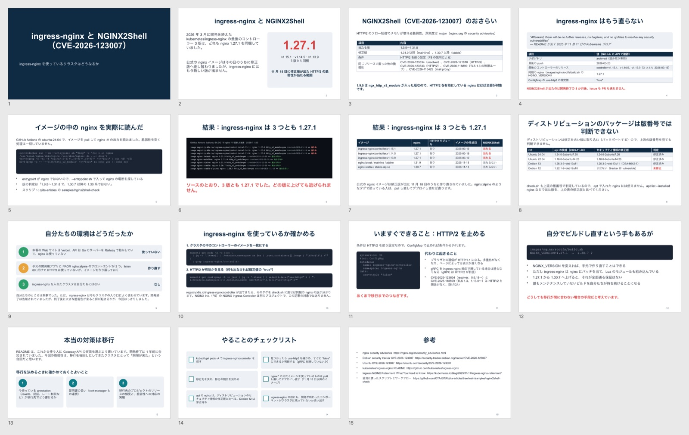
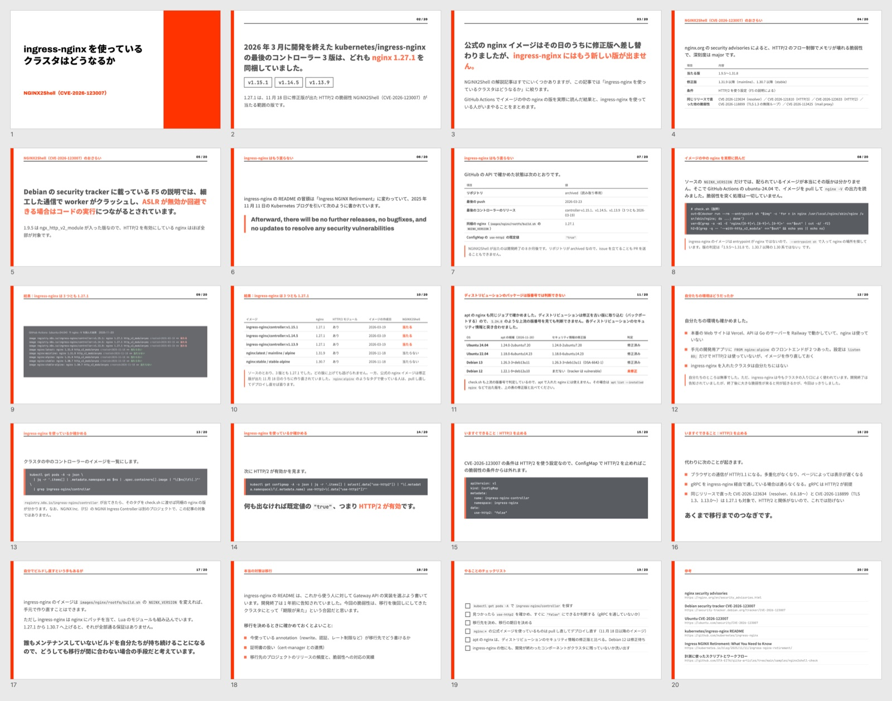
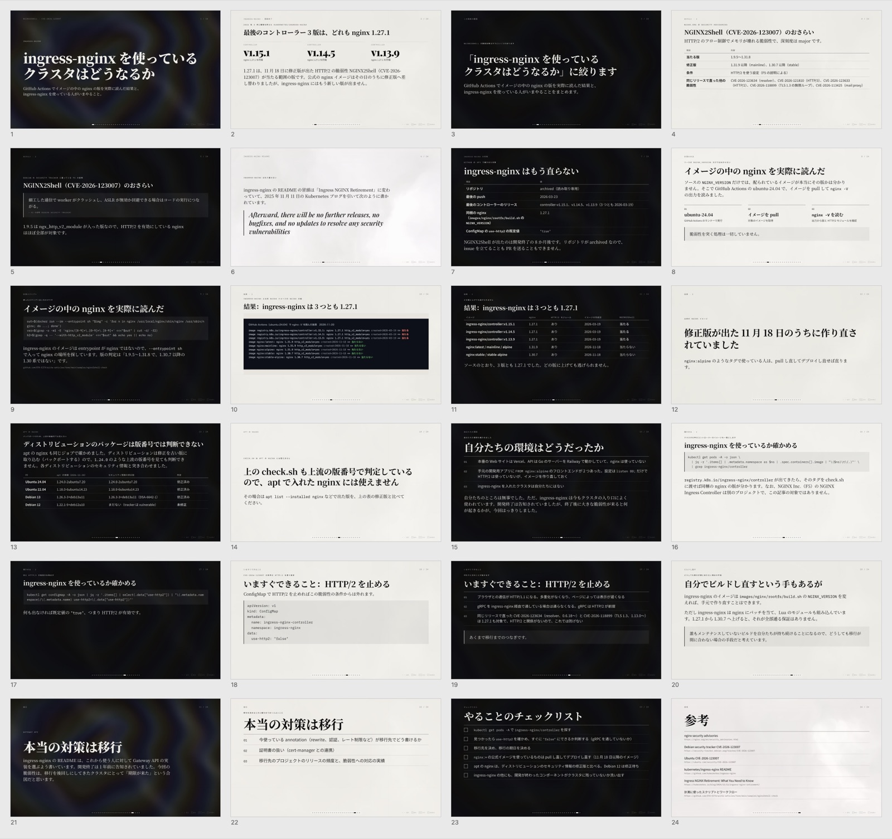
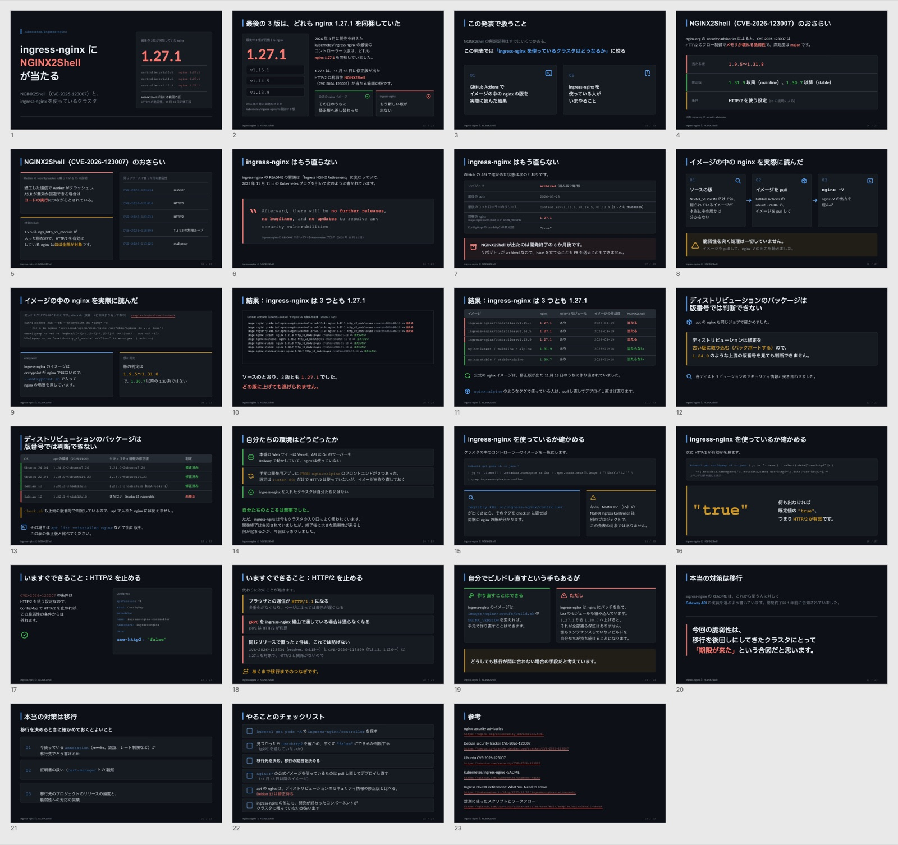
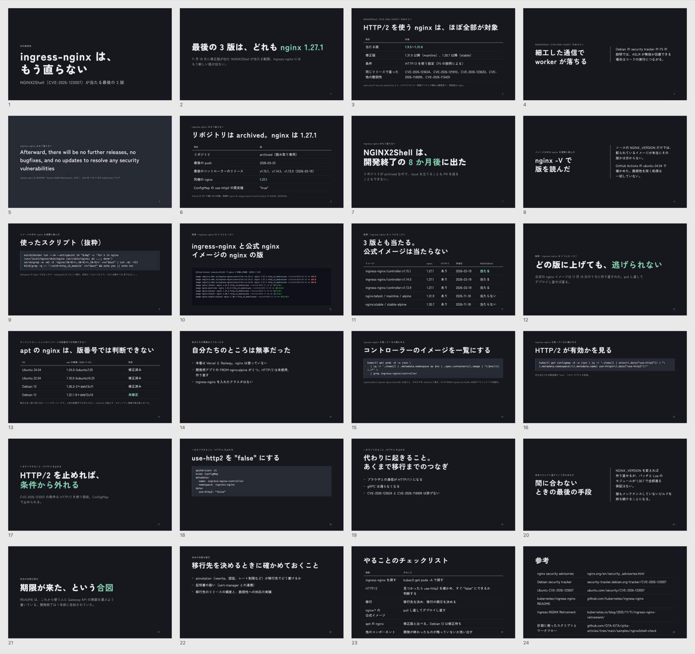

同じ原稿・同じ依頼文・同じ答えで、スライドを作るスキル 5 つにデッキを作らせ、1 枚あたりの文字数と「角丸か影の付いた箱」の数を数えました。箱は 0 個のスキルが 3 つ、19 個が 1 つ、100 個が 1 つでした。「話しながら見せる」と答えたのに、1 枚の文字数の中央値が 250 字を超えたスキルが 4 つありました。

比べたのは、Anthropic の pptx スキル、Nuco さんの記事「[部下がClaudeっぽいスライドしか出してこなくてウンザリしてる上司はこれを使わせなさい](https://qiita.com/nuco_d/items/b279477cbcdbe5921abd)」で紹介された 3 つ、それに私たちが作った ja-slides です。ja-slides は 3 回作り直しました。その途中で分かったことも書きます。スライドをスキルに任せたい人と、自分でスキルを作る人向けです。

## Nuco さんの記事との違い

Nuco さんの記事は、公式の pptx スキルに「2×2 の格子」「60〜72pt の大きな数字」「色付きの丸に入ったアイコン」といった作り方が書かれていることを示しました。そのうえで、3 つのスキルでの作例を画像で紹介しています。この記事では、そこから次の 3 点を変えました。

- 同じ原稿・同じ依頼文で、5 つを別々の会話で作らせた
- スキルが聞いてくる質問には、人が答えずに、決めておいた答えを返した（案を選ぶ場面はいつも 1 番目の案）
- 見た目の感想ではなく、文字数・箱の数・太字の数・時間を、スクリプトで数えた

原稿は、前に書いた「[ingress-nginx の最終3版は NGINX2Shell に当たっていた](https://qiita.com/Nekorock/items/b2c66992a626ca66b963)」の本文（約 6,700 字。表 5 つ、コード 4 つ、画像 1 枚）です。

## 条件をそろえる

モデルは 5 つとも Sonnet 5.5 で、Claude Code のサブエージェントとして、スキルごとに別のフォルダで動かしました。依頼文は Nuco さんの記事とほぼ同じです。

```text:依頼文
資料元.md の内容をもとに、社内の勉強会で発表するスライドを作ってください。
- 資料元.md にない情報は足さないでください
- 順番と見出しは、資料元.md のとおりにしてください
- できあがったファイルは、このフォルダに保存してください
```

スキルが質問してきたときの答えも、全部同じにしました。

| 質問 | 答え |
|---|---|
| 場面と聞き手 | 社内のエンジニア向け勉強会。Kubernetes を触っている人 |
| 見せ方 | 発表者が話しながら見せる |
| 長さ | 20 分くらい。枚数はおまかせ |
| 素材 | 資料元.md だけ。画像はその中の 1 枚だけ |
| 案を選ぶ場面 | いちばん最初の案 |
| 構成の確認 | それで進めて |

使ったスキルの版は次のとおりです（2026-11-20 時点）。

| スキル | 出力 | ライセンス | 使った版 |
|---|---|---|---|
| pptx（Anthropic） | .pptx | 同梱の LICENSE.txt は Apache-2.0 | claude.ai から同期されていたもの |
| [frontend-slides](https://github.com/zarazhangrui/frontend-slides) | HTML | MIT | 9906a34（2026-06-23） |
| [guizang-ppt-skill](https://github.com/op7418/guizang-ppt-skill) | HTML | AGPL-3.0 | 93d21bf（2026-10-30）。更新の確認だけ飛ばした |
| [ppt-master](https://github.com/hugohe3/ppt-master) | .pptx | MIT | d8f704b（2026-11-19） |
| [ja-slides](https://github.com/OTA-EITA/skills/tree/main/ja-slides)（自作） | HTML | MIT | この記事を書いた時点の版 |

## 数えたもの

できたデッキを、HTML は Chrome の DevTools Protocol で、pptx は python-pptx で読み、1 枚ずつ数えました。スクリプトは [qiita-articles の samples/slide-skills-compare](https://github.com/OTA-EITA/qiita-articles/tree/main/samples/slide-skills-compare) に置いています。

- **文字数**: 1 枚の中の文字（空白を除く）。表とコードも含めた
- **150 字を超えた枚数**: 話しながら見せるスライドで、150 字はかなり多い
- **箱**: スライドの 1〜50% の大きさで、塗りか枠があり、角丸か影が付いた要素
- **太字**: 見出し以外の太字の要素
- **時間**: サブエージェントが始めてから終わるまで

## 結果

| スキル | 枚数 | 文字数（中央値） | 150 字超 | 箱 | 箱のある枚数 | 太字 | 時間 |
|---|---|---|---|---|---|---|---|
| pptx（Anthropic） | 15 | 374 | 13 | 19 | 9 | 19 | 1 分 44 秒 |
| frontend-slides | 20 | 259 | 18 | 0 | 0 | 85 | 4 分 54 秒 |
| guizang-ppt-skill | 24 | 273 | 17 | 0 | 0 | 8 | 5 分 14 秒 |
| ppt-master | 23 | 287 | 22 | **100** | 20 | 88 | 13 分 22 秒 |
| ja-slides（自作） | 24 | **129** | 11 | 0 | 0 | 18 | 3 分 3 秒 |

太字の数は、HTML と pptx で数え方が少し違います（HTML は 48px 未満で太さ 700 以上、pptx は 28pt 未満の太字）。同じ形式どうしで比べてください。

目立ったのは次の 2 つです。

- 「話しながら見せる」と答えても、1 枚の文字数の中央値は 4 つが 250 字を超えた。「資料元.md にない情報は足さない」「見出しのとおり」という依頼のせいで、原稿の文をそのまま載せる方へ寄ったのだと思う
- 箱は、スキルごとの作り方がそのまま数に出た。0 個の 3 つは、どれも罫線・帯・余白で区切っていた

## pptx（Anthropic）: レシピどおりの見た目



紺の表紙、2 枚目の箱に入った大きな「1.27.1」、番号入りの色付きの丸、チェックボックスの箱の格子。Nuco さんの記事で指摘されていた見た目がそのまま出ました。SKILL.md には今も次のように書かれています。

- 「Every slide needs a visual element」（どのスライドにも図か形を入れる）
- 「Large stat callouts (big numbers 60-72pt …)」「Icons in small colored circles next to section headers」

一方で、5 つの中では一番早く、15 枚と一番少ない枚数にまとめました。そのぶん 1 枚の文字数は一番多く（中央値 374 字）、表の字は 12〜13pt まで小さくなりました。スキル自身が下限にしている 14pt を下回っていると、作業の記録にも書かれていました。

## frontend-slides: 見本から選べるが、文字は多いまま



最初に用途・長さ・密度を聞き、見本を 3 つ作ってから選ばせる流れでした。1 番目の Swiss Modern（白・黒・赤）を選んでいます。箱は 0 個で、左の赤い帯とページ番号の罫線だけで全体をそろえていて、見た目の統一感は一番ありました。

ただ、密度は「Low density / speaker-led」（1 枚にアイデア 1 つ、箇条書き 3 つまで）を選んだのに、文字数の中央値は 259 字でした。原稿の段落をほぼそのまま載せたスライドが多く、強調の赤い太字も 85 か所あります。「1 枚 1 メッセージ」は、見本を選ぶ仕組みとは別に、原稿を削る手順がないと守られないようです。

## guizang-ppt-skill: 雑誌のような見出し、中身は原稿のまま



明朝体の大きな見出しで、暗い地と明るい地を交互に使っていました。型から選び、同じ構成を続けないという決まりは守られていて、24 枚を並べても単調ではありません。太字は 8 か所と一番少なく、強弱は字の大きさと書体でつけていました。

気をつける点が 2 つありました。

- テンプレートの書体の指定が、中国語（簡体字）用の Noto Serif SC / Noto Sans SC から始まる。今回の環境では日本語の字形で表示されていた（「直」の左の縦画で確認）が、環境によっては中国語の字形になるかもしれない
- PDF の書き出しの手順がなく、1 枚ずつ画面を撮って PDF にまとめた。発表者用のノートを作らなかったので、スキルの検証スクリプトは「ノートが 0 枚」を 1 件のエラーとして出した

## ppt-master: 作り込みは一番、箱も一番



方針の確認（聞き手・目的・資料のその後）、3 案からの選択、仕様書（design_spec.md）とロックファイル（spec_lock.md）の作成を経てから、1 枚ずつ SVG を描いて pptx に変換していました。1 番目の案は暗い地のターミナル風で、23 枚とも配色と書体がそろっています。

その代わり、23 枚中 20 枚に角丸の箱があり、合計 100 個でした。左に色の帯が付いた箱、アイコン付きの箱、番号付きの箱が、ほぼ全ページに出てきます。見た目の情報量は一番多いのですが、「どこが大事か」は箱の多さで薄まっていると感じました。

時間は 13 分 22 秒で、ほかの 3〜5 倍かかりました。また、手元に Yu Gothic がないため、上の画像は LibreOffice が代わりの書体で描いたものです。PowerPoint で開くと、字の幅が少し違うはずです。

## 自作の ja-slides: 文字数を半分にした



ja-slides は、3 つのスキルから考え方を借り（コードと文章は使っていません）、日本語の発表に合わせて組み直したものです。

- 最初に 5 つを 1 回で聞き、方向性の違う見本 3 案を画像で見せて選ばせる（frontend-slides の考え方）
- 色・書体・字の大きさを `deck.lock.json` に固定し、5 枚ごとに読み直す（ppt-master の考え方）
- レイアウトは用意した 13 の型だけ、同じ型を 3 枚続けない（guizang-ppt-skill の考え方）
- 台本の段階で「1 枚で言いたい一文」を決め、発表の分数 × 1.2 枚を上限にする
- 点検スクリプトで、はみ出し・24px 未満の字・同じ型の連続・3 行以上の見出し・行をまたいで割れた英数字の語を NG にする

文字数の中央値は 129 字で、ほかの 4 つの半分以下でした。箱は 0 個です。表とコードは原稿のまま載せているので、150 字を超えた 11 枚は、すべて表・コード・引用のページでした。

## 自分のスキルは 3 回作り直した

ja-slides も、1 回目からうまくいったわけではありません。同じ条件で 3 回動かし、毎回サブエージェントに「スキルの指示で分かりにくかったところ・スクリプトが邪魔をしたところ」を書かせて直しました。

| 回 | 枚数 | 文字数（中央値） | 出た問題 | 直したこと |
|---|---|---|---|---|
| 1 | 27 | 130 | 点検が「結果が取れなかった」で何度も止まる。直したのに古い画像が残る。指摘 11 件 | Chrome を DevTools Protocol で動かし、Web フォントの読み込みを待ってから測るように書き直した。テーマから作る `new` を足した |
| 2 | **36** | 110 | 「見出しは元のとおり」を守るために足したルールのせいで、20 分の発表が 36 枚に膨らんだ。`ingress-nginx` が「ingress- / nginx」で割れた | 枚数の上限（分数 × 1.2）を入れた。見出しは小さな添え（kicker）に置けるようにした。語の割れを NG にした |
| 3 | 24 | 129 | 見出しが 3 行になっても点検で拾えない。1 枚だけ撮る方法が分からない | 3 行以上の見出しを NG にした。`shoot --only` を足した |

いちばん効いたのは、1 回目の「点検が不安定」という指摘でした。Chrome の `--dump-dom` で測っていたのですが、新しいプロファイルでは Web フォントを読み込む前に DOM が書き出されてしまいます。手元で 3 回試して 3 回とも失敗しました。DevTools Protocol で `document.fonts.ready` を待ってから測るようにしたところ、冷えた状態でも 3 回とも 2 秒前後で通るようになりました。

2 回目の 36 枚は、指示を足したことで別の決まりが壊れた例です。「元の見出しは節の最初の 1 枚の h1 にする」と書いたため、h1 のない型（一文だけの statement など）を節の頭に置けなくなりました。その結果、節ごとに見出しの 1 枚を別に作ることになり、36 枚まで増えました。スキルの指示は、足すたびに別の決まりとぶつからないかを見る必要があります。実際に動かすまで、それには気づけませんでした。

## 数字に出ないこと

- 1 つの原稿で 1 回ずつしか作っていない。同じスキルでも、もう一度動かせば枚数や文字数は変わる
- 案を選ぶ場面では、いつも 1 番目を選んだ。2 番目や 3 番目のほうが良かったスキルもあるはず
- 箱が多いこと自体は悪くない。ppt-master のデッキは、配って読ませる資料としては一番情報が多い
- 依頼文の「資料元.md にない情報は足さない」「見出しのとおり」は、どのスキルにとっても文字を減らしにくい条件だった
- ja-slides の 3 回目は、2 回の手直しのあとの結果なので、ほかのスキルより有利な条件で比べている

## どれを使うか

- PowerPoint で編集し続けたい、配って読ませる: ppt-master（時間はかかる）か pptx スキル（早いが定番の見た目）
- 見本を見ながら雰囲気を決めたい: frontend-slides。ただし原稿は自分で削っておく
- 雑誌のような見出しで、単調にしたくない: guizang-ppt-skill。日本語の書体の指定は確かめる
- 日本語の発表で、1 枚の文字を減らしたい: ja-slides

## 使ってみるなら

ja-slides は [OTA-EITA/skills](https://github.com/OTA-EITA/skills) に置いています。フォルダをスキルの置き場所にコピーするだけで使えます。

```sh
git clone https://github.com/OTA-EITA/skills.git
cp -R skills/ja-slides ~/.claude/skills/
```

必要なのは Node.js 22 以降と Chrome だけです。デッキを作ったあと、スキルを使わずに点検だけ回すこともできます。

```sh
node ~/.claude/skills/ja-slides/scripts/deck.mjs check deck.html
node ~/.claude/skills/ja-slides/scripts/deck.mjs sheet deck.html sheet.png
```

ほかのスキルで作ったデッキを比べたいときは、[samples/slide-skills-compare](https://github.com/OTA-EITA/qiita-articles/tree/main/samples/slide-skills-compare) の計測スクリプトがそのまま使えます。

## 参考

- 部下がClaudeっぽいスライドしか出してこなくてウンザリしてる上司はこれを使わせなさい（Nuco） https://qiita.com/nuco_d/items/b279477cbcdbe5921abd
- Improving frontend design through Skills（Anthropic） https://claude.com/blog/improving-frontend-design-through-skills
- frontend-slides https://github.com/zarazhangrui/frontend-slides
- guizang-ppt-skill https://github.com/op7418/guizang-ppt-skill
- ppt-master https://github.com/hugohe3/ppt-master
- OTA-EITA/skills（ja-slides） https://github.com/OTA-EITA/skills
