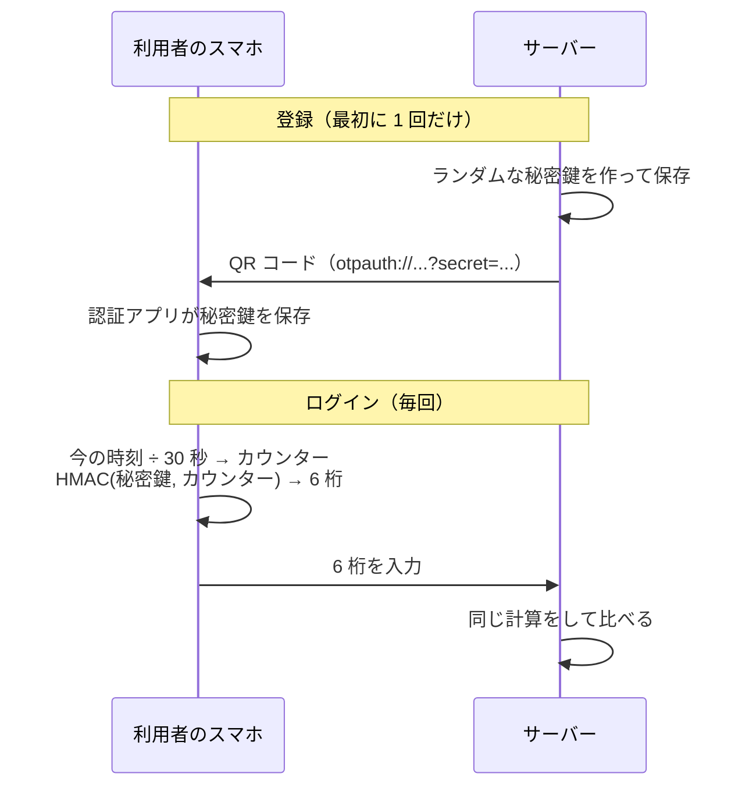

ログインのたびに、Google Authenticator や Microsoft Authenticator などの認証アプリを開いて 6 桁の数字を打ち込む。毎日やっている人も多いと思います。あの数字は TOTP（Time-based One-Time Password、時間で変わるワンタイムパスワード）という仕組みで作られていて、2 段階認証（MFA）でよく使われている方式です。

個人プロジェクトで [mamori](https://github.com/OTA-EITA/mamori) という小さな IdP（社内のログインをまとめる仕組み）を作っていて、TOTP も自分で実装しました。RFC 6238 のテストベクタは全部一致し、テストも通っていました。

ところが、この記事を書くために照合する側のコードを読み直したら、問題が 2 つ見つかりました。1 つはコメントの誤りで、もう 1 つは本物の穴でした。

コードを作る側の仕組みは、すでに分かりやすい記事がたくさんあります（最後に載せています）。この記事では、サーバーがコードを受け取って照合する側に絞って、つまずきやすいところを mamori のコードで実際に確かめながら説明します。

## この記事で触れること

- TOTP の 6 桁がどう作られ、サーバーがどう照合しているか
- 1 つのコードが実際に何秒間通るか
- 同じコードを 2 回使われないようにする方法
- 6 桁を総当たりされたときの確率と、試行回数の制限
- TOTP の秘密鍵をパスワードのようにハッシュで保存できない理由
- 先頭の 0 と「2038 年問題」の勘違い
- TOTP でも防げないこと（フィッシング）

## この記事で触れないこと

- QR コードの読み取りや認証アプリの作り方
- 復旧コードやバックアップの運用
- パスキー（WebAuthn）の仕組みそのもの
- SMS 認証との詳しい比較

## TOTP とは

たとえるなら、同じ合言葉の本と、ぴったり合わせた時計を持った 2 人です。2 人とも「今の時刻のページ」を開いて同じ計算をすれば、同じ 6 桁が出ます。片方が言った 6 桁がもう片方の答えと合えば、「この人は本を持っている」と分かります。本は秘密鍵、時刻のページは 30 秒ごとに変わるカウンターです。



ポイントは、秘密鍵は登録のときに 1 回だけ渡され、そのあとはネットワークを流れないことです。流れるのは 30 秒で使えなくなる 6 桁だけです。

計算そのものは短いです。mamori の実装（TypeScript）では、次の数行です。

```ts:src/totp/totp.ts（抜粋）
const counter = Math.floor(unixSeconds / options.stepSeconds); // 30 秒ごとに 1 増える
const hmac = createHmac('sha1', secret).update(counterBytes(counter)).digest();
const offset = hmac[hmac.length - 1]! & 0x0f; // 最後のバイトで取り出す位置を決める
const binary =
  ((hmac[offset]! & 0x7f) << 24) | (hmac[offset + 1]! << 16) | (hmac[offset + 2]! << 8) | hmac[offset + 3]!;
return String(binary % 10 ** 6).padStart(6, '0');
```

ここまでは「コードを作る」話です。ここから先が、この記事の本題の「照合する」話です。

## 試した条件

- 2026 年 11 月 5 日、macOS、Node.js 24（`--experimental-strip-types` で TypeScript をそのまま実行）
- mamori の `src/totp/totp.ts`。RFC 6238 付録 B の 18 個のテストベクタを含むテストは 32 件すべて通る
- 秘密鍵は RFC のテスト用の `12345678901234567890`、6 桁、30 秒ごと、前後 1 ステップまで許す設定（認証アプリと同じ初期値）
- 実験に使ったスクリプトは [samples/totp-verify-intro](https://github.com/OTA-EITA/qiita-articles/tree/main/samples/totp-verify-intro) に置いています。mamori を clone した隣に置けば同じ結果になります

## 落とし穴 1：1 つのコードは 30 秒ではなく 90 秒通る

認証アプリの表示は 30 秒で切り替わりますが、スマホとサーバーの時計は少しずれていますし、打ち込むのにも時間がかかります。そこでサーバーは、今のコードだけでなく、1 つ前と 1 つ後のコードも受け付けるのが普通です。

RFC 6238 にもこう書かれています。

> We RECOMMEND that at most one time step is allowed as the network delay.

では、1 つのコードは実際に何秒間通るのか。ステップの始まりで作ったコードを、前後 120 秒の範囲で 1 秒ずつ照合してみました。

```console
$ node --experimental-strip-types experiments.ts
t0 % 30 = 0 code 732303 accepted from -30 to 59 seconds = 90
```

作った時刻の 30 秒前から 59 秒後まで、合わせて 90 秒間通りました。前後を 2 ステップずつ許すと 150 秒になります。広げるほど打ち間違いや時計のずれには強くなりますが、盗み見られたコードが使える時間も延びます。RFC が「1 ステップまで」を勧めているのはこのためです。

## 落とし穴 2：同じコードを 2 回使えてしまう

90 秒通るということは、その間に同じコードをもう一度送れば、それも通るということです。肩越しに見られたり、通信の途中で読まれたりしたコードを、本人のすぐあとに使われるかもしれません。

RFC 6238 は、これをはっきり禁じています。

> The verifier MUST NOT accept the second attempt of the OTP after the successful validation has been issued for the first OTP

防ぎ方は単純で、照合に成功したときのカウンターを保存し、それ以下のカウンターのコードは受け付けないようにします。mamori では、ユーザーごとに `totp_last_counter` という列に保存しています。

```console
first true second with lastUsedCounter false second without true
```

1 回目は通り、保存したカウンターを渡すと 5 秒後の 2 回目は弾かれました。カウンターを渡さないと、2 回目もそのまま通ります。照合の関数がどれだけ正しくても、呼ぶ側が前回の値を覚えていなければ、ワンタイムではなくなります。

## 落とし穴 3：6 桁は総当たりできる

6 桁は 100 万通りしかありません。前後 1 ステップまで許していると、どの瞬間にも正解が 3 つあるので、でたらめに 1 回打って当たる確率は 100 万分の 3 です。

これを何回まで試せるかで、話が大きく変わります。

| 試せる回数 | 少なくとも 1 回当たる確率 |
|---|---|
| 10 回 | 約 0.003% |
| 1 日 2,880 回（30 秒に 1 回） | 約 0.86% |
| 30 日 86,400 回（30 秒に 1 回） | 約 23% |
| 制限なし（1 秒に 100 回） | 1 時間で約 66%、1 日でほぼ 100% |

もちろん、この段階まで来られるのはパスワードを知っている人だけです。ただ、TOTP はまさに「パスワードが漏れたとき」のためにあるので、この確率は気にする必要があります。RFC 4226 も、サーバー側で試行回数を制限することを勧めています（RP2: throttling/lockout scheme is RECOMMENDED）。

### mamori で見つかった穴

mamori のパスワードの画面には、試行回数の制限がありました。同じメールアドレスと IP から 15 分に 10 回失敗すると締め出し、メールアドレスごとに 6 回目以降の失敗は答えるまでの待ち時間を 1, 2, 4... 秒と倍にしていきます。設計書にもそう書いていました。

ところが TOTP の画面では、失敗の回数は数えていたものの、待ち時間をかけていませんでした。パスワードを知っている人なら、同じ IP から 10 回までは待たずに 6 桁を試せ、IP を変えればその分だけ回数が増えます。

テストを足して、直す前のコードで動かすと、待ち時間が 1 回もかかっていないことが分かりました。

```console
AssertionError: expected [] to deeply equal [ +0, +0, +0, +0, +0, +0, 1, 2, 4, 8 ]
```

TOTP の照合の前にも、パスワードと同じ締め出しの確認と待ち時間を入れて直しました（[コミット](https://github.com/OTA-EITA/mamori/commit/0e03b6a427e5b2a9970e564d7f04c4251f0938e5)）。

```ts:src/oidc/interactions.ts（抜粋）
if (throttle.isLocked(key, ip)) {
  pendingTotp.delete(uid);
  return send(res, 429, loginPage(uid, { client: clientName, error: 'Too many failed attempts. Try again in 15 minutes.' }));
}
await sleep(throttle.delaySeconds(key));
```

ログインの画面が 2 段になると、制限を 1 段目にだけ付けて満足しがちです。2 段目の 6 桁は、1 段目のパスワードよりずっと短い分、むしろ制限が要ります。

## 落とし穴 4：秘密鍵はハッシュにできない

パスワードは、元の文字列を保存せずにハッシュ（bcrypt や scrypt など）だけを保存します。ログインのときは、入力された文字列をハッシュにして比べればよいからです。

TOTP の秘密鍵は、そうはいきません。サーバーは毎回、秘密鍵そのものから 6 桁を計算するので、元の値が要ります。

| | パスワード | TOTP の秘密鍵 |
|---|---|---|
| サーバーが比べるもの | 入力をハッシュにしたもの | 秘密鍵から計算した 6 桁 |
| 保存するもの | ハッシュだけでよい | 元の値が要る |
| データベースが漏れたら | ハッシュを解かれるまでは使えない | すぐに全員分の 6 桁を作れる |

RFC 6238 も、秘密鍵は不正なアクセスから守るべきだとしています（R7: SHOULD be protected against unauthorized access and usage）。データベースに入れるなら、データベースとは別の場所に置いた鍵で暗号化しておき、データベースだけが漏れても秘密鍵は読めないようにするのが一般的です。

正直に書くと、mamori v0.1 は今のところ秘密鍵を SQLite にそのまま保存しています。ここは次に直すところです。

## 落とし穴 5：先頭の 0 と「2038 年問題」

最後は、実装を書いていると引っかかりやすい細かい話を 2 つ。

### 先頭の 0

6 桁は数字ですが、数値として扱ってはいけません。RFC のテストベクタには `07081804` のように 0 から始まるものがあり、数値にすると先頭の 0 が消えます。

```console
RFC vector 07081804 as number 7081804 verify as number: false
```

桁数が足りないので照合に失敗します。利用者から見ると、10 回に 1 回くらい、正しいコードを打っているのに通らないという、原因の分かりにくい不具合になります。コードは最初から最後まで文字列として扱います。

### 2038 年問題の勘違い

ここで見つかったのが、冒頭のコメントの誤りです。mamori のコードには、もともとこう書いていました。

```ts
// The counter exceeds 2^31 for timestamps after 2038 at 30-second steps
```

「2038 年以降はカウンターが 32 ビットに収まらない」という意味ですが、計算してみると違いました。カウンターは Unix 時刻を 30 で割った数なので、32 ビット（符号付き）を超えるのは西暦 4011 年です。RFC のテストベクタで一番遠い 2603 年（t = 20000000000）でも、カウンターは 666,666,666 で、32 ビットに収まります。

```console
t 20000000000 counter 666666666 > 2^32? false right 65353130 32bit 65353130
```

2038 年に 32 ビットを超えるのは、カウンターではなく Unix 時刻（秒）のほうです。JavaScript なら、時刻にビット演算を使うと簡単に壊れます。

```console
$ node -e 'const t = 2200000000; console.log(t | 0)'   # 2039 年 9 月
-2094967296
```

RFC 6238 には「2038 年以降は、時刻の値 T を 32 ビットより大きく扱えなければならない」とあります。

RFC の T は時刻を 30 秒で割った値なので、30 秒ごとなら 2038 年に 32 ビットを超えることはありません。実際に気をつけるのは、割る前の Unix 時刻のほうです。カウンター自体は RFC 4226 で 8 バイトと決まっているので、どのみち 8 バイトで書きます。mamori のコメントは直しました。

## TOTP でも防げないこと

ここまでの対策を全部入れても、TOTP には防げない攻撃があります。フィッシングです。

本物そっくりの偽のログイン画面に、利用者がパスワードと 6 桁を入れると、攻撃者はそれをすぐに本物のサイトに打ち込みます。6 桁は 90 秒通るので、中継には十分です。6 桁には「どのサイトに入力されたか」の情報が含まれていないので、サーバーには本物の利用者と区別できません。

パスキーが強いのは、ここです。パスキーは登録したサイトのドメインと結び付いていて、偽のドメインでは使われません。パスキーの仕組みは、[パスキー認証入門（Zenn）](https://zenn.dev/ikkik/articles/b4ad621e0f7bac) が分かりやすいです。

| | TOTP | パスキー |
|---|---|---|
| ネットワークを流れるもの | 90 秒使える 6 桁 | そのサイトとその回専用の署名 |
| サーバーが持つもの | 秘密鍵（元の値） | 公開鍵だけ |
| 偽サイトに入力したら | 中継されて使われる | そもそも使われない |
| 総当たり | 6 桁なので制限が要る | 当てようがない |

TOTP は、パスワードだけよりはずっと安全です。ただ、フィッシングに強い認証が使えるなら、そちらを優先したほうがよいです。mamori も、次の v0.2 でパスキーを入れる予定です。

## 総まとめ：サーバーで照合するときに確かめること

| 確かめること | なぜ |
|---|---|
| 許すのは前後 1 ステップまで | 広げるほど、盗まれたコードが使える時間が延びる |
| 成功したカウンターを保存し、それ以下は弾く | RFC の MUST。しないと 90 秒の間に同じコードを使い回せる |
| 2 段目の 6 桁にも試行回数の制限をかける | 100 万通りしかない |
| 秘密鍵は暗号化し、鍵は別の場所に置く | ハッシュにできず、漏れたらすぐ使われる |
| コードは文字列のまま比べる（比較は時間が一定の関数で） | 先頭の 0 が消える。比べる時間から中身を推測されない |
| 時刻を 32 ビットの計算に通さない | 2038 年に壊れる |
| フィッシングが心配ならパスキーを優先する | TOTP は中継を防げない |

TOTP の計算は数行ですが、その数行がテストベクタと一致しても、照合する側の作りが甘ければ安全にはなりません。自分の個人プロジェクトのコードも、読み直すまでは「テストが全部通っているから大丈夫」と思っていました。

## 参考

- [RFC 6238: TOTP: Time-Based One-Time Password Algorithm](https://www.rfc-editor.org/rfc/rfc6238)
- [RFC 4226: HOTP: An HMAC-Based One-Time Password Algorithm](https://www.rfc-editor.org/rfc/rfc4226)
- [パスキー認証入門: 次世代の安全なログイン方法を理解する（Zenn, ikkik）](https://zenn.dev/ikkik/articles/b4ad621e0f7bac)
- [TOTPを再実装してみた、OJT初日のMFA地獄を糧に（Qiita, shonakam）](https://qiita.com/shonakam/items/b2cce6816a7c94d66bef)：コードを作る側の実装
- [TOTP を原理から理解する：RFC 4226 / 6238 準拠の CLI を Rust で書いた（Qiita, sen-ltd）](https://qiita.com/sen-ltd/items/0d62637e431232db0e20)
- [認証アプリの6桁コードを自作 ─ なぜ TOTP はフィッシング耐性がないのか（Qiita, omochi_0604）](https://qiita.com/omochi_0604/items/b2b8fc618769e1654173)
- [OTA-EITA/mamori](https://github.com/OTA-EITA/mamori)
